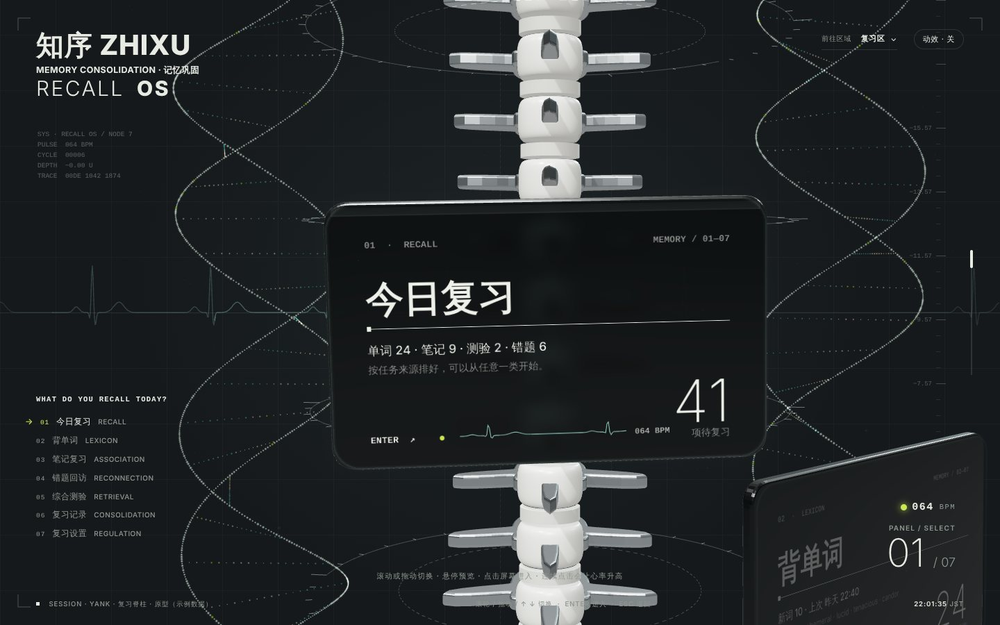
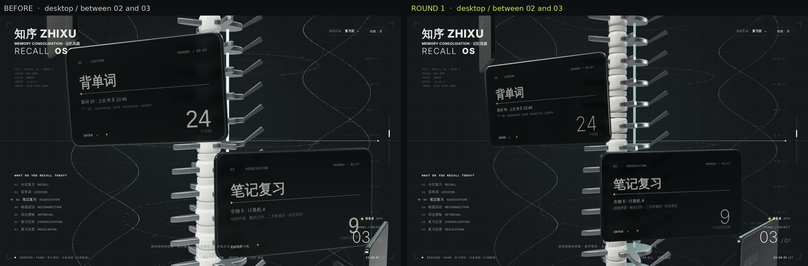
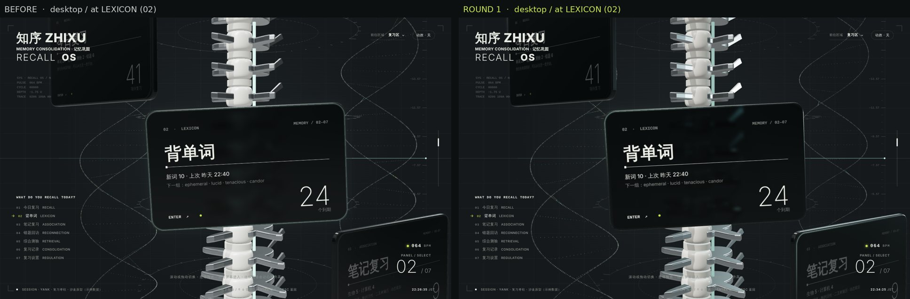
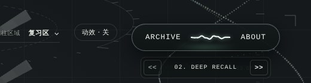
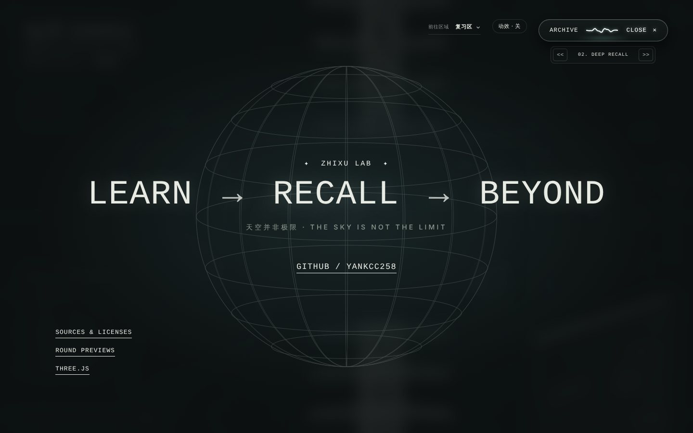
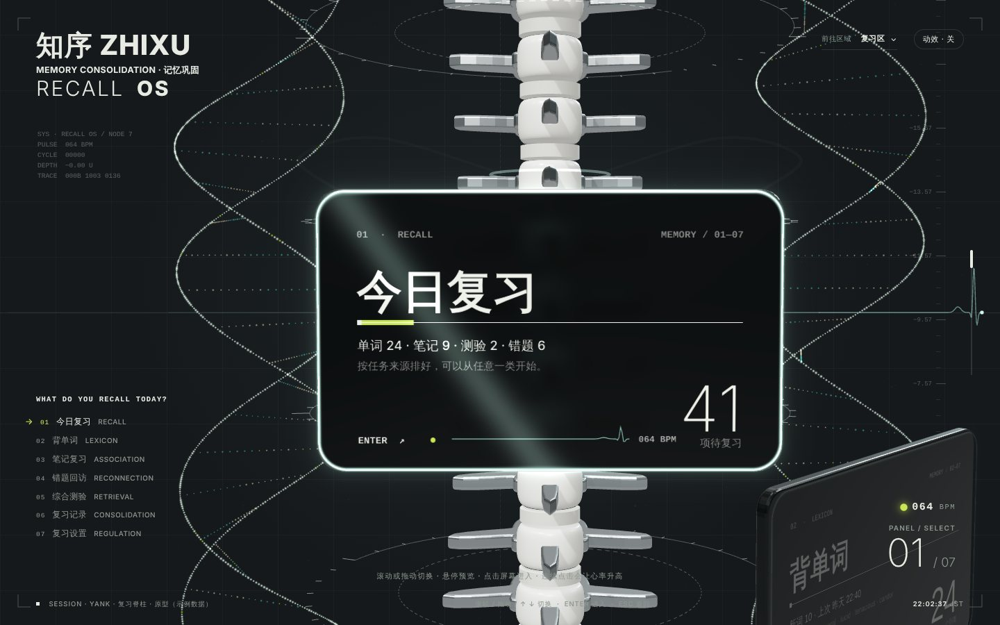
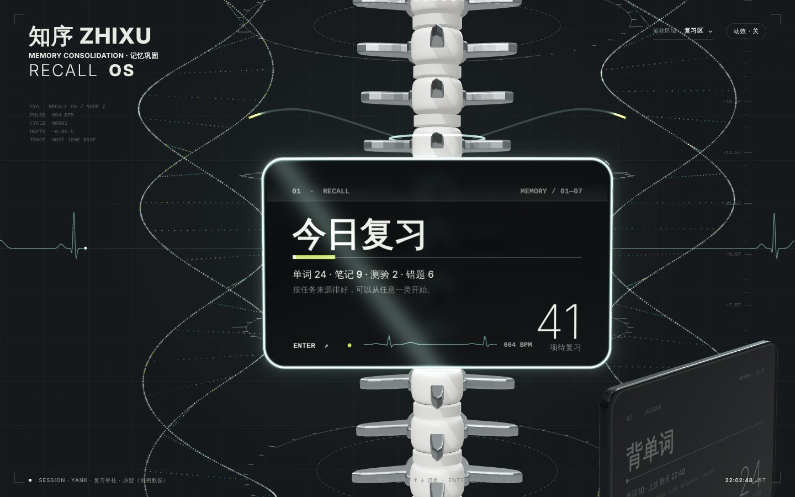
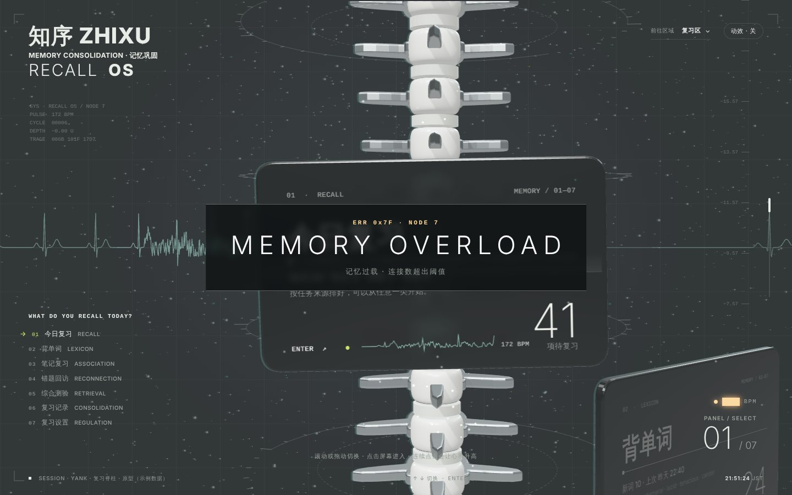

# 知序 · 复习区沙盒

[知序](https://github.com/yankcc258/yank-study-lab)复习区的视觉与交互试验场。这里的页面都是独立的静态原型，不接正式站的接口和数据，内容都是示例。

当前原型：**复习脊柱**（`index.html`）。

当前骨架已替换为**有机脊柱第三稿**：保留确认过的楔形椎体、凹端面、片状骨弓和贴合关节，新增开槽钛支撑片、六角紧固件及后方连接件。象牙白、钛金属和椎间层配色保持不变。

- [可旋转的高精度模型](preview/organic-spine/)：九节造型，支持整体、关节、单节、线框及展开查看。
- 根页面使用 73 节连续骨架，九种轮廓渐变往返排列，关节按实际姿态拟合；运行资产约 2.56 MiB、43 万三角形，重复部件实例化。高精度资产仅在独立模型预览加载。
- 这一轮只替换独立测试沙盒的模型；七个入口、镜头、DNA、光照、音乐和背单词交互沿用原版。`preview/round-0`、`preview/round-1` 保留。
- [模型接入与验证记录](docs/organic-spine-v3.md)。
- 接入后修正（露娜）：脊柱是 S 形排列的，「脊髓」改为沿每节椎孔中心（椎骨局部 `(0, 0, -0.19)`）穿过的曲线，不再是一根直圆柱；神经过渡的椎骨光环和神经起点按新椎骨的宽度调整；手机上心率读数移到曲目框下方，进入内容后内容层盖在胶囊导航上面。

当前界面加入 **记忆生命体 ZH-01** 设定：背单词对应大脑，其余入口分别对应循环、关联、修复、感知、生长与稳态系统。玻璃屏幕带原创细线结构图，左侧显示标本说明。背景模拟脉搏根据有效点击的实际间隔定拍，停下后缓慢恢复；详见[系统设定与点击联动](docs/living-specimen.md)。



## 打开方式

用任意静态服务器打开仓库根目录即可，例如：

```sh
python3 -m http.server 8080
```

然后访问 <http://127.0.0.1:8080/>。不能直接双击 `index.html`：页面用了 ES 模块，浏览器要求通过 HTTP 加载。

也可以在仓库设置里开启 GitHub Pages（分支 `main`、根目录），根目录已有 `.nojekyll`。

地址参数：

- `?motion=0`：关闭动效
- `?i=3`：直接停在第 4 块屏幕

## 画面

- **脊柱**：中心一根有机与无机结合的脊柱。九种独立建模的楔形象牙白椎体，配片状钛骨弓、贴合关节和小型无机连接件；椎孔里穿一根发光的「脊髓」。
- **DNA**：左右两条光点组成的双螺旋（骨架链、两色碱基对、大沟小沟），相位错开半圈交替排列，缓慢自转并一直往下延续。
- **屏幕**：七块深色磨砂玻璃屏幕沿螺旋从左往右下沉。边缘发光，各自极慢地摆动；当前屏幕上有扫描线和迷你心电图。
- **背景**：极淡的网格、取景框、深度标尺、数据读数、横贯画面的心电图、每块屏幕高度上的刻度扫描环，以及缓慢上浮的微尘。

## 本轮精修（镜头、遮挡、光照 → 背单词屏幕）

分两轮交付，每轮都保留冻结的可操作预览和同尺寸、同入口的前后对比图：

- 各轮预览入口：[`preview/`](preview/)（`round-0` 调整前、`round-1` 第一轮……）
- 对比图：`docs/compare/round-N/`（左「之前」、右「本轮」）

### 第一轮：镜头连续性、遮挡与纵深、共同光照

- **镜头**：滚轮和拖动连续控制沿螺旋前进的进度，一小格滚轮只移动一小段；停手 0.16 秒后平缓吸附到最近的入口，新的输入随时接管；拖动松手带一点惯性；越过两端有少量余量后吸回。两个入口之间，镜头角度略微领先、稍微退后、视线往脊柱收，能同时看到前一块的侧面、后一块的正面和中间的骨架。左侧列表、方向键准确跳转；关闭动效时直接到位。
- **DNA**：不再一比一跟着镜头转，只以 0.45 倍速度跟随，产生视差；两条链一近一远（远的更淡），会从脊柱后面经过、被屏幕遮住，或只在边缘露出一截。光点亮度和随心跳的放大都调弱了，避免干扰阅读。
- **光照**：主光从镜头左上前方、侧光从右侧略后方、轮廓光从背后；环境光和半球光压低，暗部留在暗处。瓷质椎体降低亮度、提高粗糙度；脊髓光线调暗。玻璃粗糙度降低、反射略增，更能透出后方结构；屏幕排版底下垫一层柔和的深色渐变，文字对比度稳定。边缘光只点亮朝向主光的那几条边，屏幕越侧向镜头越亮。扫描环和刻度调淡。
- **手机**：窄屏不画背景读数和标尺数字；底部入口列表压一层底色。




## 胶囊导航与关于页

右上角一枚胶囊：左 **ARCHIVE** 回到螺旋最上面（在内容页里会先返回）；中间一条波是**背景音乐开关**，播放时随音量起伏、暂停时拉成直线；右 **ABOUT** 打开关于页，打开后变成 **CLOSE ✕**（ESC 也能关）。胶囊下面的小框切换曲目。

音乐不是音频文件，而是浏览器里用 Web Audio 实时合成的三首氛围长音（缓慢换和弦、低通滤波呼吸、交叉回声），没有版权问题；要换成自己的音乐，可以在 `recall-dock.js` 里改成播放音频文件。交互思路借鉴了同人站的胶囊导航，代码和音乐全部自写。




## 交互

| 操作                          | 效果                                                                                                                                                     |
| ----------------------------- | -------------------------------------------------------------------------------------------------------------------------------------------------------- |
| 滚轮、向上拖动、↑ ↓、左侧列表 | 沿螺旋切换屏幕                                                                                                                                           |
| 鼠标悬停在屏幕上              | 屏幕摆正、放大，扫过一道光，标题放大，上方椎骨和屏幕之间的神经淡淡亮起                                                                                   |
| 点击当前屏幕或按 ENTER        | 过渡动画：椎骨亮起，两条神经长到屏幕上角，光脉冲流进屏幕，镜头推近，进入内容页                                                                           |
| 进入背单词（或今日复习）      | 一组 8 个示例单词：空格 / 点卡片翻面，1 忘了、2 模糊、3 记得；忘了的隔三张再出现，模糊的放到队尾再来一次；结束后显示统计，背单词和今日复习的数字同步减少 |
| ESC                           | 返回螺旋                                                                                                                                                 |
| 在总览里连续点击              | 点击间隔决定目标模拟脉搏，每次点击写入脉冲；停止后恢复 64 BPM。拖动、右键、答题和音乐控件不计入                                                             |
| 高频点击且模拟脉搏达到 152    | 三秒内至少九次有效点击才触发「记忆过载」彩蛋；信号中断、重新校准后恢复                                                                                     |





## 文件

| 文件                              | 内容                                                                                 |
| --------------------------------- | ------------------------------------------------------------------------------------ |
| `index.html` / `recall-spine.css` | 页面结构和样式                                                                       |
| `recall-spine.js`                 | 场景、屏幕、镜头、交互、进入过渡（`TRANSITIONS` 注册表，七个入口以后可各自登记一套） |
| `recall-backdrop.js`              | 心跳、心电图、过载时间线，以及 2D 背景层                                             |
| `recall-vocab.js`                 | 背单词示例（单词卡、翻面、评分、队列、统计）                                         |
| `models/spine.js`                 | 脊柱、DNA、扫描环、微尘的几何与着色器                                                |
| `vendor/three/`                   | three.js r170（MIT，许可见同目录）                                                   |
| `assets/fonts/`                   | Inter 字体（SIL OFL 1.1，许可见同目录）                                              |

屏幕默认显示复习信息。要给某块屏幕加背景图，在 `recall-spine.js` 顶部的 `IMAGES` 里登记，例如 `IMAGES.vocab = 'assets/img/vocab.jpg'`。

## 来源与许可

- 版式受一个《明日方舟》同人展示站（[reverieach/rhine-lab-art](https://github.com/reverieach/rhine-lab-art)）的「中心脊柱 + 玻璃屏幕螺旋排列」启发。该站的场景、着色器、模型和贴图没有开源许可，CG 和标志属于鹰角网络，所以这里**只参考了版式思路**：代码、模型、着色器全部自写，没有使用该站的任何文件、名字或标志。
- 本仓库代码采用 MIT 许可（见 `LICENSE`）。three.js 与 Inter 字体保留各自的许可。
- 以后加入的图片请确认来源和授权。

## 已知限制

- 只做了深色；手机版能用，但没有精细排版。
- 透射玻璃加每帧重画屏幕纹理比较吃性能，流畅度需要在真机上确认。
- 七个入口的专属过渡动画还没做，目前都用默认的「神经」过渡。
