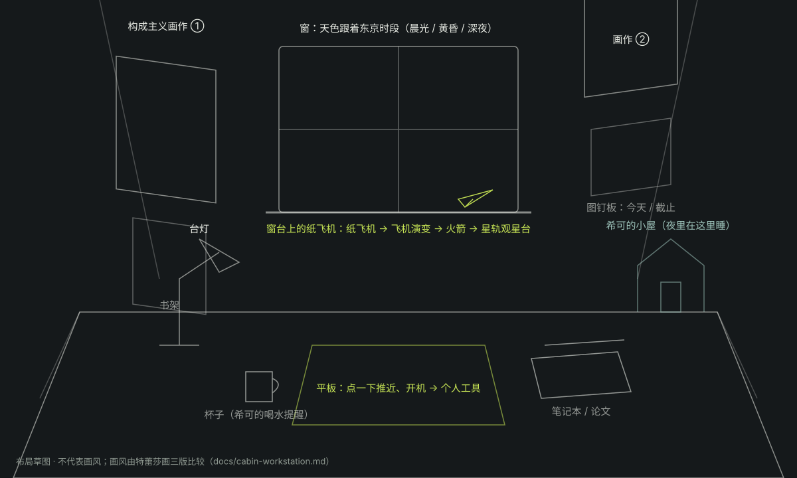

# 小屋 · 研究员工作站（设计稿说明）

2026-11-01 · 露娜整理，Yank、特蕾莎和 Codex 一起讨论。目前**只定方向和大致布局**，画风由特蕾莎画三版来比较，不急着做。

## 一、它在知序里的位置

知序有三个区域，连起来是一个故事，也就是关于页那句 `LEARN → RECALL → BEYOND · 天空并非极限`：

| 区域     | 主题                        | 画面                                     |
| -------- | --------------------------- | ---------------------------------------- |
| 实验室   | LEARN · 学习                | 缎带卡片雕塑，深石墨                     |
| 复习区   | RECALL · 复习               | 记忆生命体的脊柱，深石墨                 |
| **小屋** | **BEYOND · 研究员的工作站** | 一个人的研究桌，窗外是天空，最后通向星空 |

小屋就是 Yank 自己的研究站：个人事务都在这里，原来的星轨观星台在这里重新开放，成为单纯的观星平台（星星、星象、天文事件）。希可平时也住在这里。

## 二、视角：坐在桌前

- **第一人称，坐在书桌前**：正前方是桌面和窗户，左右两面墙挂画。
- **拖动只能稍微转头**：左右约 ±25°，上下约 ±10°。松手后慢慢回正。
- **点物件，镜头推近**：点平板、纸飞机、画作时，镜头推过去；返回时退回座位。
- **手机**：画面竖着裁，看到的是桌面、平板和窗户；左右两面墙靠左右滑动查看。

布局草图（只表示东西摆在哪里，不代表画风）：

## 三、桌上和墙上的东西

| 物件              | 位置               | 点了会怎样                                                                                                                                 |
| ----------------- | ------------------ | ------------------------------------------------------------------------------------------------------------------------------------------ |
| **平板**          | 桌面正中           | 镜头推近，平板开机（开机动画），然后显示个人工具：课表、番茄钟、论文、健康、出愿、备考、大狼陪学。这些现在散在小屋大厅里，以后都收进平板。 |
| **纸飞机**        | 窗台               | 起飞动画（见第四节），最后进入星轨观星台。                                                                                                 |
| **窗户**          | 桌子正前方         | 窗外天色跟着东京时段走（晨光 / 黄昏 / 深夜，固定为自动），夜里能看到星星。                                                                 |
| **构成主义画作**  | 左墙一幅、右墙一幅 | 镜头推近，旁边一行小字写作品名、作者、年份和来源。                                                                                         |
| **图钉板**        | 右墙下方           | 钉着今天的课和快到期的事，点开进对应工具。                                                                                                 |
| **台灯**          | 桌面左侧           | 夜里自动亮；点一下开关，只影响氛围，不改设置。                                                                                             |
| **杯子**          | 平板左边           | 希可提醒喝水时，杯子会亮一下。                                                                                                             |
| **笔记本 / 论文** | 桌面右侧           | 进入论文和笔记相关的工具。                                                                                                                 |
| **书架**          | 左墙下方           | 先做装饰，以后可以放「已读完」的资料。                                                                                                     |
| **希可的小屋**    | 桌面右后角         | 希可的家（专属模型，待建）。                                                                                                               |

## 四、纸飞机 → 星空

点窗台上的纸飞机后，它飞出窗外，画面跟着它往前，同一条航线一路变形：

1. **纸飞机**：从窗台起飞，穿过窗户。
2. **莱特兄弟的飞行者一号**（1903）：双翼、木架、螺旋桨。
3. **双螺旋桨飞机**：螺旋桨客机时代。
4. **喷气式飞机**：后掠翼喷气客机。
5. **航天飞机**：一路爬升，天色从蓝变暗。
6. **火箭**：穿出大气层，星星亮起来。
7. **星空**：镜头慢慢转向地球，无缝进入原来的星轨观星台（已有内容预览：`preview/starfield/`）。

火箭冲出大气层的那一刻，可以浮出齐奥尔科夫斯基的那句话：「地球是人类的摇篮，但人不能永远生活在摇篮里。」

做法上的约定：

- 每一种飞行器都由我们自己画剪影，不用任何航空公司、机构的涂装和标志。
- 总长控制在 8～10 秒，可以跳过。关闭动效时直接进入观星台。
- 从观星台返回时，镜头退回到桌前，纸飞机已经回到窗台上。

## 五、希可

希可是 Yank、特蕾莎和 Codex 三个人一起做出来的角色，延续现在完整的桌宠设计（嘴毒、认真讲解、会吃会睡、节日装扮）。在新空间里：

- **身份**：知序的研究助手，住在小屋，桌面右后角有她的专属小屋模型（待建）。
- **平时**：在小屋里当桌宠。
- **偶尔串门**：跳到实验室和复习区吐槽、提醒，比如该背单词了、该喝水了。背单词时请她「🐋 讲讲这个词」，学习卡和回想卡上都有这个按钮（v2.48.1）。
- **夜里**：钻回自己的小屋睡觉。
- **待定**：她的工作站造型（比如白大褂）交给你们三个决定。

## 六、画风：请特蕾莎画三版比较

三版都用同一个构图，也就是第二节的「坐在桌前」视角，桌面、窗户、两面墙的画都要有，这样好放在一起比。三版都会挂构成主义画作，区别在于整个房间的基调。

### A. 复古未来研究站

- **年代感**：上世纪六七十年代太空时代的研究室。
- **材质**：木桌、金属仪器、旋钮和拨杆、绿色荧光屏、钉在墙上的图纸和星图。
- **颜色**：暖木色、黄铜、橄榄绿，夜里是台灯的暖光加窗外的蓝。
- **和故事的关系**：和「纸飞机 → 火箭」最合。和石墨色的实验室、脊柱拉开差别，像是从实验室回到了自己的房间。

### B. 延续石墨细线

- **配色**：和实验室、脊柱同一套，深石墨、象牙白、黄绿。
- **材质**：家具和仪器都是干净的实体，边缘用细线勾出来。
- **强色**：画作是房间里唯一的强色。
- **特点**：整站最统一，三个区域像同一栋建筑里的三个房间。

### C. 构成主义为主基调

- **整体**：房间本身就是一幅构成主义作品。
- **元素**：红、黑、米白的几何块面，强斜线，大字排版；家具也按这套语言做。
- **特点**：冲击力最强，但和前两个区域差别最大，切换过去时会很跳。

## 七、构成主义画作的来源

- **优先公有领域**：比如马列维奇、利西茨基、波波娃、克卢西斯，他们去世得早，在大多数国家已经进入公有领域。罗德琴科在一些国家要到 2027 年起才进入公有领域。**每一张都要确认来源和授权再用**，来源写在作品旁边的小字和 README 里。
- **或者自己画**：由我们画原创的构成主义风格作品，完全没有版权问题。
- **选画方向**：优先选**抽象构成**的作品（几何、色块、排版），少用带大标语的宣传画，免得画面压过学习网站本身的气质。
- **和「飞」呼应的题材**：塔特林的人力扑翼机 Letatlin、利西茨基的几何构成。

## 八、还没定的事

1. **画风**：A、B、C 选哪个，等特蕾莎画完再比。
2. **希可**：她的专属小屋和工作站造型。
3. **平板里放哪些工具、怎么排**。
4. **开场频率**：以后在小屋的设置里调（现在默认每个窗口只播一次）。
5. **先做哪个**：先在沙盒做一个只有基本形状的白模，试视角和交互，还是等画风定了再一起做。
