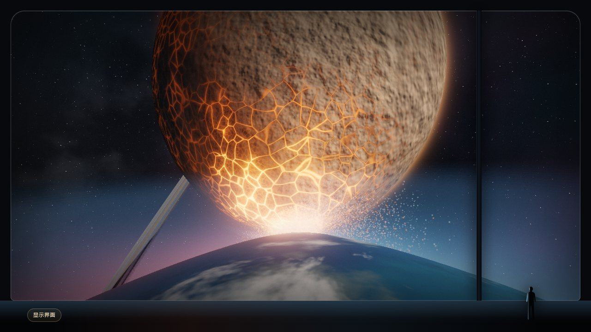

# 展品 02 · 洛希极限

2026-11-11 · 猫猫做的样稿，按 Yank 的要求（「另外一个视觉前端，是洛希极限的」）。特蕾莎随后完成浏览器检查，并按用户的电影参考图继续打磨双星观测。正式站和冻结的学习区未修改。

## 星云潮汐观景舱（2026-11-11，精修版接入）

发布状态：Yank 已明确确认“合入 main 并发布”；[PR #1](https://github.com/yankcc258/test-sandbox/pull/1) 已合入 `main`（合并提交 `4ea5aac`），由沙盒 GitHub Pages 发布。此前保留在分支上的要求已解除。正式入口为 [洛希极限展品](https://yankcc258.github.io/test-sandbox/exhibits/roche/)。

本轮视觉修整：缩小左下光核的高亮范围，收紧红色晕光，降低横向散光、地平线染红和地板倒影；保留原位置的发光点与纵向光柱。银河带从左上方斜穿远景，使用独立的暗尘通道与疏密星点，和向左下汇流的星云形成不同走向。观察舱增加低反光金属肩部、嵌入式门槛、哑光地板和分段导光线，标题避开光柱，镜头控制区改为内嵌仪表。



Yank 确认本地精修静帧后，要求接入洛希极限展品并提交至 `maomao/exhibits-roche-twins-and-blackhole-hdr`，`main` 先不动。本节是当前版本，后文保留旧版设计和物理模型记录。

- 构图来自确认稿：巨型星球只露出右侧轮廓，周围是破碎、不规则的星云和光丝；物质流汇向左下方红色光源。白粉色亮点、纵向红色光柱、地平线、窗框和观测者均保留。
- `vista.js` 直接内置完整渲染器，无本地 study 文件依赖。体积采样 128 层，分层阴影、细丝、高动态范围辉光和胶片曲线；红色光核有连续柔光，不再出现硬圆边。
- 主画面默认播放。全景 / 星云 / 光源三个镜头；拖动或方向键转头，Home 回全景；暂停 / 继续、×1 / ×4 / ×16、隐藏界面（H）与恢复（Esc）。暂停恢复完整分辨率，播放时保留按帧时自适应分辨率。
- 全景固定机位，星体不绕着画面跑；云层缓慢旋转，细流向光源移动。倍速作用于同一个视觉时钟，暂停同时停止所有纹理运动。`?motion=0` 或系统减少动态效果时暂停；镜头过渡在减少动态效果下立即完成。
- 首次准备画面时显示加载提示；支持 `KHR_parallel_shader_compile` 的浏览器异步等待编译。上下文丢失时停帧，恢复后重建；没有浮点目标时保留 8 位渲染，没有 WebGL2 时下方教学模型仍可使用。
- 面向 PC / iPad。窄画幅保持横向视野以留住红色光源；不因竖屏把光源裁掉。iPad 真机性能仍需实际体验。

### 计算边界与教学模型

主画面的星体尺度、星云密度与亮度、流动速度和光柱均为艺术化设计，不是天体动力学求解或喷流模拟。遮挡由射线与球面的交点决定。观景舱显示视觉播放时间，不再沿用旧双星的物理读数。

`binary.js`、旧 `scene.js` 和 `moon/` 均未修改。下方洛希瓣示意图继续使用原有效势、形状和周期计算，计算读数移到示意图旁；滑杆只控制该教学模型，不改变主画面。碎石卫星实验保留原入口。

### 检查入口

- `npm run check`：全仓数值、入口与文档检查。
- `scripts/check-roche-binary-browser.mjs`：云层实际像素变化、视觉时钟与倍速、教学滑杆、镜头、触摸布局、HDR / 8 位 / 无 WebGL2、上下文恢复。
- `scripts/check-roche-cinema-browser.mjs`：桌面、iPad 横竖屏的真实动画循环、暂停与镜头过渡。
- 浏览器脚本支持 `BROWSER_CHANNEL=chrome`、`PLAYWRIGHT_PATH`；受限网络环境可设 `PREVIEW_ROOT` 为仓库根目录，使用文件支持的请求路由，不必下载浏览器或访问外网。

验证记录：上述数值检查与两个浏览器脚本通过；Chrome / RTX 4070 Ti 下 HDR 开启，真实循环、云层像素变化、×4 倍速、暂停恢复全分辨率、教学滑杆、三维降级与上下文恢复通过，未报 WebGL 错误。iPad 横竖屏为浏览器尺寸及触摸模拟，尚未在 iPad 真机测帧率。另保存 10 秒 ×4 实时播放实录供 Yank 查看。

## 历史：旋涡行星带（2026-11-11 夜，第五版，猫猫）

Yank 看了下面两节说的合并版，说：「感觉你们都没有弄出来我图里想要的效果，搞得好丑。」我对着他的参考图重看了一遍，问题是我只读出了「要大」，没有照着图做：

- 图的主角是天上那片发光的旋涡盘。合并版的主角是一颗橙棕色的裂纹行星，行星带只剩一条细线。而他最早说的就是「互相拉扯着那个行星带」。
- 图是青蓝为主、地平线上一点洋红，干净柔和的大色块和光晕。合并版是橙、棕、黑，堆满程序生成的裂纹、斑块和颗粒。

这一版先出了一张静帧给他确认方向（他说「方向对」），再做成会动的。**以后给他做画面，都先出静帧。**

### 画面里有什么

- **行星带是主角**：一片横过天空的旋涡，两条旋臂，沿旋臂有细丝，臂与臂之间是暗的；内缘有两股细流落向两颗行星。旋臂跟着两颗行星一起转，细丝沿着旋臂慢慢流。
- **两颗行星在旋涡中心**：暗的剪影，烛阴一圈红边、望舒一圈青边，尖端之间一个亮点。望远镜的「双星」档会慢慢推过去对准它们，能看清泪滴形。
- **脚下是一条暗蓝的地平线**：带子外面一颗小卫星，观景舱在它上空。左边地平线上是恒星，一道竖的红色光柱。
- **落地窗、映着窗外的地板、窗边的人影**。
- 进场只有标题和底部工具条（全景 / 双星、暂停、观测仪表、隐藏界面）；读数、「两星靠得多近」的滑杆和倍速收在仪表里。横着拖是稍微转头，竖着划是翻页。

### 哪些是算的，哪些是画的

- **算的**：两颗行星的形状（有效势的等值面，逐像素沿视线求交，和 `binary.js` 是同一个势）、它们的位置和转动、读数、下半页的洛希瓣和拉格朗日点。
- **画的**：行星带。双星外面的盘会被搅出两条旋臂、内缘有两股流落向行星，这是真实的现象；但这里的亮度、颜色、花纹、旋臂卷得多紧、细丝怎么流，是照着效果画的，**不是逐粒算的**。旋臂的图案以两颗行星互绕的角速度整体转动。
- **其余示意**：脚下的小卫星和观景舱（新加的虚构设定：两颗行星都在天上了，地平线只能是别的东西）、恒星的光柱、落地窗和地板、行星表面很淡的纹理、尖端伸到 L₁ 的九成时中间就开始发亮、时间流速。

### 代码

- `exhibits/roche/vista.js`：新的渲染器。场景一遍、辉光、最后一遍（窗框、地板的倒影、光柱、胶片曲线）。有浮点渲染目标走高动态范围，没有就用 8 位目标。
- `exhibits/roche/main.js`：重写，短了很多。
- **`exhibits/roche/scene.js` 现在没有页面在用**。它是前几版的渲染器和一百万粒试验粒子的积分（显卡和 CPU 两套），`check-roche-binary.mjs` 仍然在检查它的规则。先留着：以后要是想在望远镜档里放真的在算的碎屑，可以从它接；不要的话整个删掉，连同检查里对应的几段。这一条请 Yank 定。

### 验证

- `npm run check`：全部通过。
- `scripts/check-roche-binary-browser.mjs`（Playwright，Chrome）：六段全部通过。桌面一段里读了画布的像素：行星带是亮的、偏蓝，恒星是亮的，窗框是暗的；读数和公式对得上；一倍速 30 秒正好四分之一圈，×4 正好一圈，暂停不走；望远镜两档、转头和回正、滑杆、仪表、隐藏界面。另外五段：平板竖屏和横屏（两倍像素比、触摸）、没有浮点渲染目标、没有 WebGL2、上下文丢失和恢复。
- `scripts/check-roche-cinema-browser.mjs`（特蕾莎写的，按新页面改过）：桌面、iPad 横屏、iPad 竖屏三段全部通过，其中动画是真的让页面自己跑的。
- 我自己看过的是静帧：全景几个相位、望远镜档、平板尺寸。**连续播放时好不好看，我没法自己看，要 Yank 看。**

### 没做完的，和请审的地方

- iPad 真机没验。
- 行星带是画的这件事，页面小字里写了，但画面上没有任何提示。
- 竖屏时恒星在画面左边界之外，只剩一片红晕。
- `scene.js` 留还是删（见上）。
- 下面各节是前几版的记录，说的画面已经不在页面上了。

## 上一版：两版合并（2026-11-11 晚，猫猫）

> 这一节和后面的「观测舱影像定稿」「巨构视角」「双星观测」说的都是已经被第五版替换掉的画面，留作记录。

同一天，特蕾莎和我各按 Yank 的那张参考图改了一版双星主页面，互不知道：她的「观测舱影像定稿」（下一节，当时已合进 `main` 上线）仍然从远处用长焦看；我的「巨构视角」（再下一节）把机位搬到了行星跟前。我推送时发现撞了，两版改的是同一批文件，只能选一边。问了 Yank，他定的是：**用巨构视角，把特蕾莎那一版的亮点移植过来**。

所以这个分支上的主页面是：

- **机位、行星、大气、行星带、镜头、落地窗和人影**：巨构视角那一版，见「巨构视角」一节。
- **从特蕾莎那一版移植的**：
  - 碎屑的椭圆足迹：每一粒的足迹沿它真实速度在屏幕上的方向拉长，透明度按面积补偿，一粒粒的点连成细丝。因为镜头跟着两颗行星一起转，我用的是减掉「跟着转」那一部分以后的速度；拉多长由 `blur`（0.012 个时间单位）定，最多五倍。位置和受力不变，没有另画轨迹。
  - 进场只有标题和底部工具条；读数和控制台收在「观测仪表」里，按需展开。工具条上另有四个机位、暂停和隐藏界面（H 键）。
  - 她写的 `scripts/check-roche-cinema-browser.mjs` 留着，按新机位改了三处：标注默认开着（行星直径是用来比大小的）、原来的「切到物质桥档位」换成「切到 L₄ 机位」、回正检查的是转头角度。
- **没有移植的**（都在她那一节里写着，`main` 的历史里也在）：6.4° 的长焦构图和倾斜的舷窗、「彼此的边界」标题、冷蓝的配色、高离面碎屑的发光权重。她修的「大气辉边在 L₁ 附近出现大块三角光雾」，巨构视角里用另一种办法处理了（见那一节的「哪些是算的」）。
- 黑洞展品这次没有动，合并进来的是特蕾莎的「巨构构图」。

合并以后：`npm run check` 全部通过；`check-roche-binary-browser.mjs` 六段、`check-roche-cinema-browser.mjs` 三段（桌面、iPad 横屏、iPad 竖屏）全部通过。「巨构视角」一节里写的「隐藏界面的按钮在左下角」「碎屑贴近了看是一粒粒小点」已经过时：按钮在工具条上，碎屑现在是沿流向的短丝。

## 观测舱影像定稿（2026-11-11，特蕾莎）

> 这一节说的是合并之前、当时在 `main` 上线的那一版主页面。这个分支上它已经被上一节说的合并版替换，保留在这里是为了说明移植过来的东西原本怎么做的。

视觉目标为 PC / iPad，手机不再决定画质取舍。参考用户提供的 GIF 中冷蓝逆光、倾斜环带与舷窗的尺度关系，保留双星设定，使用程序纹理与实时渲染，没有复制参考图素材。

- 默认视场收窄至 6.4°，观测高度 9°、舷窗视野轻微倾斜；望远镜缓慢切换全景 / 双星 / 物质桥。近处蓝色窗缘、跨越画面的尘带和大面积星体暗面构成尺度参照。质量、形状、双星与碎屑的轨道、时间倍率不变。
- 默认只显示「彼此的边界」标题和底部暂停 / 仪表入口；读数和控制面板按需展开。洛希瓣与标注默认关闭，可以在仪表里打开；物质桥近景淡出标题。支持键盘、指针、iPad 触摸操作。
- 用同一批积分粒子的柔和椭圆足迹表现尘带，长轴沿真实速度的屏幕投影，按面积补偿透明度；没有添加固定圆环或伪造物质流轨迹。收窄亮部层次，减少原来砂粒般的亮点；炽热碎屑偏红、冰尘偏蓝，尖端高密度粒子的发光权重降低，避免饱和白斑。
- 岩石细裂缝减少整面铺亮，冰星大气与极光改为冷蓝色，星空和胶片颗粒减弱。大气辉边把势差除以局部梯度近似高度，修正 L1 附近平坦势造成的大块三角光雾；这只影响成像，不改变表面求交结果或粒子受力。
- `binary.js`、GPU `DUST_STEP` 和 CPU 粒子推进保持原样。半透明足迹、发光权重、色调、大气、镜头都是视觉示意；第三版原有的「九成开始流」和内缘补回规则仍是示意，未升级成真实的流体辐射模拟。碎石卫星子页未修改。
- `npm run check` 全量通过；双星原浏览器检查（GPU / CPU、HDR 降级、无 WebGL2、上下文恢复）通过。新增 `check-roche-cinema-browser.mjs` 覆盖 PC 1440×900、iPad 横屏 1194×834 / 竖屏 834×1194（触摸及 DPR 2 模拟）的实际动画推进、暂停、抽屉、镜头切换、标注与 WebGL 错误。桌面 GPU 的尺寸模拟不等于 iPad 真机持续帧率 / 发热验收。


这件展品现在有两页：

- **主页面 `exhibits/roche/`：双星观测**（第三、四版）。两颗虚构的行星站在彼此的洛希极限上，从贴着行星的观景舱看。先读「巨构视角」，再读「双星观测」。
- **子页面 `exhibits/roche/moon/`：碎石卫星实验**（第一、二版）。一颗碎石堆卫星被推过洛希极限，撕成环。「电影化重做」一节往后都是它的说明，内容没有变，只是换了路径。


## 巨构视角（同日第四版）

Yank 看了第三版，给了一张参考图（空间站的落地窗、窗边一个很小的人、脚下是行星的地平线、天上是占满画面的巨大天体），说：「这种电影的宏大感才是我想要的，既然是星体，就该是这种巨构一样的东西。」同时定了：**手机不考虑，只做电脑和 iPad**。

第三版的毛病是机位在 13 倍间距以外用望远镜看，两颗行星在画面里是两个小球。这一版物理一点没动，改的是「从哪里看」和「看到的东西画得多细」。

### 改了什么

- **机位搬进了星系里面**。四个机位，都固定在跟着两颗行星一起转的坐标里：
  - 望舒上空（默认）：离地约 440 千米，靠近朝着烛阴的那一侧。脚下是望舒的地平线，烛阴的直径在眼里张开 67°，从头顶一直垂到地平线，两个尖端正好在地平线上相接。
  - 烛阴上空：反过来，脚下是烛阴开裂的地面，望舒悬在天上。
  - 两界之间：停在两个尖端旁边，左右各是一颗行星，像两堵墙。
  - L₄：和两颗行星成等边三角形的那个点上方，两颗行星和整条行星带都在画面里。
- **一圈就是一天**。机位跟着转，所以两颗行星在窗外不动，动的是恒星：日出、被天上那颗行星遮住、白天、日落、夜里。一倍速下一圈 120 秒（原来 55 秒，大的东西动得慢）。开场的相位挑在恒星刚从地平线上、烛阴旁边升起来的时候。
- **比大小的东西**：落地窗、地板、窗边一个站着的人影（页面上的装饰）；画面上标着行星的直径；读数里有离地高度和天上那颗行星张开多少度。
- **行星表面贴近了也有细节**。噪声按离镜头的远近分层淡入（最多九层）。烛阴的地壳是一块块的板，板缝里是熔岩，只有尖端附近整片发亮；三层地形明暗。望舒有云影、海面的反光、细碎的云团。
- **大气**：视线擦过行星时，按离表面最近时的高度算一圈辉边；打到地面时，掠着看的地方沉进一层雾里。晨昏线附近偏红。
- **行星带**除了逐粒的碎屑，再按半径上的疏密逐像素画成一片连续的薄盘（和撒碎屑用的是同一个疏密函数），两颗行星的影子落在上面。
- **镜头**：恒星在画面里时有横向的拉丝、一道竖的光柱和几个光斑；露出来几成由页面朝恒星圆面上的七个点各看一眼算出来。
- 去掉了望远镜的十字丝和三个档位。拖动是转头（左右 ±80°、上下 ±38°），滚轮变焦，Home 回正，H 键或左下角的按钮隐藏界面。

### 这一版里哪些是算的

- 四个机位的位置、行星张开的角度、地平线在哪、恒星什么时候升起和被遮住，都是按两颗行星的尺寸和等势面算的，不是摆的。
- 求行星表面的办法换了：原来在包围球里等步长走，贴近了地平线会锯齿、擦边的光线会漏；现在用「势差 ÷ 梯度」估计离表面还有多远，按这个距离往前走，过了面再二分。两个尖端之间梯度趋近零，这个估计会失真，分母里补了一项势差。
- **修了一个第三版就有的错**：同一个势值在对面那颗行星里也围着一圈等值面。靠近尖端的地方，原来会把对面行星里的那一圈当成这一颗——画面上是尖端附近一圈圈错的影子，碎屑的落地判定里是少数碎屑还没碰到望舒就被算成落在烛阴上。现在画面、碎屑（显卡和 CPU 两套）和「恒星有没有被挡住」都只认两个尖端中间那个面的本侧。
- 从尖端扯出来的碎屑，出生时散开的范围从 0.16 倍缩到 0.07 倍包围半径（贴近了看，原来是一大团）。这是示意的参数，`check-roche-binary.mjs` 仍然通过。

### 这一版新加的示意

- **观景舱能悬在行星上空不动**。真的要这样，得一直开着发动机，或者是一座从地面伸上来的塔。L₄ 那个机位也抬高了 0.95 倍间距，不在 L₄ 本身。
- 大气的厚度被放大了很多（辉边的标高约 0.013 倍间距，差不多 190 千米）。
- 物质桥中间那道光芯（烛阴一头是火的颜色，望舒一头是冰汽的颜色）是直接画的一道光，不是碎屑。
- 行星带那片连续的薄盘上更细的环缝；它画到 5.6 倍间距，比碎屑铺的范围（3.95 倍）宽。
- 板块、裂缝、云、极光、海面反光、镜头的拉丝和光斑、一点分色。

### 验证

- `npm run check`：全部通过（碎屑规则改了以后 `check-roche-binary.mjs` 仍然通过）。
- `scripts/check-roche-binary-browser.mjs`（Playwright，Chrome）：六段全部通过——桌面显卡后端（四个机位、读数、转头和回正、隐藏界面、暂停、把两星拉开后不再有碎屑被扯出来）、平板竖屏 820×1180 和横屏 1180×820（两倍像素比，面板不出界、不互相压着）、CPU 后端加不走后期、没有 WebGL2、上下文丢失和恢复。手机那一段删了。
- 帧率：这台机器（RTX 4070 Ti，Chrome，1080p）让页面自己连续跑 8 秒，「望舒上空」和「两界之间」的帧间隔中位数都是 3.6 毫秒，画质没有自动降档。
- 画面是我自己对着截图一轮轮调的，四个机位、日出 / 被遮住 / 白天 / 夜里几个相位都看过。

### 没做完的，和请审的地方

- **iPad 真机没验**，只在电脑上用平板的尺寸和两倍像素比跑过。逐像素求两颗行星的表面比第三版更重；降级还是只会降分辨率和求交步数。核显也没验。
- 被扯出来的碎屑贴近了看是一粒粒的小点，像火星，不像一道连续的流。
- 烛阴的板块是规则的蜂窝状，贴近了能看出是程序生成的。
- 行星的边缘仍然没有抗锯齿。
- 下面「双星观测」一节里关于机位（13 倍间距、望远镜档位）和手机尺寸的话已经过时，其余仍然成立。
- 请审：「观景舱悬着不动」这个设定要不要在页面上说得更显眼；大气放大了这么多会不会误导。

## 双星观测（同日第三版）

Yank 试了第二版以后说想改成：「两个行星之间的，完全虚构两个行星，让他们在相互的洛希极限上互相拉扯着那个行星带，视角是观测者的视角，比如在一个很远的空间站上面观测」。这一版就是照这个做的。

### 画面里有什么

- **两颗行星**：烛阴（占总质量 65%，干热的岩石行星，潮汐把地壳扯出发光的裂缝）和望舒（35%，冰和海的行星，夜面有极光）。它们绕共同质心做圆轨道，彼此潮汐锁定，都被拉成泪滴形，尖端朝着对方。
- **物质桥**：尖端伸到 L₁ 附近，烛阴被扯出炽热的岩屑，望舒被扯出水汽和冰晶，越过 L₁ 落向对方。
- **行星带**：1.85–3.95 倍间距处绕着两颗行星的一圈碎屑。内缘不稳定，碎屑不断被两颗行星扯走。
- **观测舱**：相机固定在 13 倍间距外、比轨道面高 6.5° 的地方，逆着光看；舷窗的窗框、读数和望远镜的十字丝是页面上的装饰。可以拖动转方向、滚轮变焦，三个望远镜档位（全景 / 双星 / 物质桥）。

### 哪些是算出来的

单位：两星间距 a = 1，G(M_A + M_B) = 1，角速度 1。μ = M_B / (M_A + M_B) = 0.35。跟着两星一起转的坐标里，有效势是

```
Ω(u, w, h) = ½ (u² + w²) + (1 − μ) / r_A + μ / r_B
```

- **行星的形状**是 Ω 的等值面（洛希模型：质量当成集中在中心，表面是引力加离心力的等势面）。画面里每个像素沿视线在行星的包围球里等步长找这个面，过了面再二分；法线是 Ω 的梯度。所以泪滴形、尖端朝向 L₁、越近越尖，都是这个势的结果，不是建的模型。`binary.js` 的 `planetShape`、`volumeRadius` 给出尖端、背面、侧面、极向的尺寸和等体积半径；充满洛希瓣时和 Eggleton (1983) 的公式相差不到 1%。
- **五个拉格朗日点**和洛希瓣（过 L₁ 的等势面）画在画面上，是同一个势求出来的。
- **碎屑**是圆型限制性三体问题里的试验粒子：只受两颗行星的引力，不算自己的引力。在惯性系里先踢后漂逐粒积分，桌面 105 万粒，在显卡上每帧推进（`scene.js` 的 `DUST_STEP`）；CPU 上是同一套规则。雅可比常数在 10 圈里漂移小于 10⁻³。
- **行星带内缘被扯走**是算出来的：2.4 倍间距以外绕 12 圈还在原处，1.5 倍处的会落到行星上或被甩走。
- **互相的影子**：恒星只比轨道面高 7°，每转一圈两颗行星各把对方遮住一次；行星表面的影子沿光线对另一颗行星的等势面求交，碎屑的影子按行星的侧向半宽近似。
- **读数**：间距（千米）按烛阴等体积半径 6,400 千米换算；周期由望舒的密度 3.4 g/cm³ 和形状算出（间距取成 1 以后，周期只和密度、形状有关），约 5.7 小时；由此烛阴的密度约 2.7 g/cm³。

### 哪些是示意

- 两颗行星完全是虚构的，名字、质量比、大小、密度都是我定的。
- 行星的地貌、云、极光、熔岩裂缝的位置和亮度、大气的辉边。潮汐加热是真的现象，但这里的亮度没有任何计算依据。
- **物质从九成就开始流**：尖端伸到 L₁ 的 88% 起就有碎屑被扯出来，到 99% 最多。真实里要等行星充满洛希瓣（100%）。被扯出来的碎屑带的初速度也是定的：多数很慢，少数快的会绕着行星甩出弧线。
- **行星带会被补回来**：落到行星上或被甩远的碎屑，重新放到带子的内缘（1.85–2.3 倍间距）。当作带子自己在慢慢向内扩散。
- 行星带一圈圈的疏密是开始时摆的，不是共振刻出来的。
- 碎屑的颜色、大小、亮度（余烬的冷却、冰尘逆光的散射）；辉光和胶片曲线；时间流速。
- 滑杆改的是「尖端伸到 L₁ 的几成」。换算成间距时假定行星的体积不变，实际上把两颗行星拉近拉远，它们的形状会跟着变，但不会这样瞬间到位。

### 验证

- `node scripts/check-roche-binary.mjs`（在 `npm run check:exhibits` 里）：通过，约 1 秒。拉格朗日点是驻点、等质量时对称、小质量极限趋近希尔半径；泪滴形状和 Eggleton 公式；周期随密度的 −1/2 次方；坐标变换；雅可比常数；零速度面把碎屑关在洛希瓣里；行星带的稳定和内缘被扯走；着色器里是同一个势和同一个积分；碎屑的出生、待命、补回规则，以及没有碎屑待在行星里面。
- 内置浏览器（Chrome 152，RTX 4070 Ti）手动看过：1280×800 下三个望远镜档位、375×812 手机尺寸（无横向溢出，6.5 万粒）、`?sim=cpu&hdr=0`（CPU 推 1.6 万粒、不走后期）、下半页的等势线示意图。把一百万粒往前推 14 秒的模拟时间用了 171 毫秒。

### 没做完的，和请审的地方

- `scripts/check-roche-binary-browser.mjs` 后来用 Playwright（Chrome）跑过，五段全部通过；第一次跑时有一条断言写得太死（要求点暂停之前一粒碎屑都没有），已改。
- **没有看过连续的动画**。我调画面的时候内置浏览器的面板在后台被限速，几乎不出帧；我是用 `window.zhixuRocheBinaryAdvance(秒)` 把时间往前推、再看静帧的。所以转动是否流畅、帧率多少、望远镜换档的过渡好不好看，都没有验。
- 手机真机和核显没验。逐像素求两颗行星的表面加上互相的影子比较重；现在的降级只会降分辨率和求交步数。
- 行星的边缘没有抗锯齿（靠大气的辉边盖住）。
- 被扯出来的碎屑大多聚在 L₁ 附近成一团亮斑，绕着行星甩出的弧线在画面里不明显。
- 请审：洛希模型用在两颗差不多大的固态行星上合不合适的说法；「九成就开始流」这个示意会不会误导；页面文字。


## 电影化重做（同日第二版）

第一版物理是对的，但 Yank 看了说「视觉效果并不是很惊艳」：只有 4096 颗哑光小球、稀疏的点状环、全靠滑杆。这一版物理核心不动，重做了画面和体验：

- **一分钟的影片**。打开页面停在开场，点「开始 · 坠向洛希极限」后依次是：远处 → 靠近 → 撕开 → 散开 → 成环，最后是逆光镜头。镜头、倍速和字幕是编排的，**物理仍然是实时算的**；「撕开」那一幕会等卫星真的被撕开才往下走。随时可以点「自己动手」换成原来的控制面板。
- **冰尘**。每颗碎石带 64 粒（手机 32 粒）细冰尘，一共 26 万粒，把环画成连续的一片。它们是示意，规则见下。
- **光影**。高动态范围渲染、辉光和胶片曲线；从太阳方向的影子图让碎石堆有明暗面；行星的影子落在环上，环和卫星的影子落在行星上；冰尘逆光时向前散射而发亮；卫星背光的一面有行星的反照；太阳本身、行星大气的金边、银河和尘埃带。
- **质感**。碎石画成大小不一、有棱角的石块；外壳是脏的冰，往里是岩石和暗红的核，撕开以后能看到里面的颜色流出来。

## 这是什么

几千颗碎石靠自身引力聚成一颗卫星，绕着一颗土星密度的行星转。它螺旋靠近行星，先被拉成指向行星的长条，再从两端漏出碎石，碎石沿轨道散开成环。页面上半屏是这个 N 体模拟，下半页是希尔球的二维示意、一把标着土星环实际位置的标尺和说明。

最要紧的一条：**没有任何代码写着「过线就碎」**。每颗碎石只受行星的引力、其他碎石的引力和接触力；解体是算出来的，极限线只是画在轨道面上的参考线。

## 物理与数学约定

单位取行星半径 R = 1、GM = 1，半径 d 的圆轨道角速度是 d^-1.5。行星是固定在原点的点质量，轨道面是 x–z，轴取 +y，卫星绕行方向和展品 01 的盘相同。q = 卫星体密度 / 行星平均密度；M = R = 1 时卫星质量 m = q r³，所以极限只和 q 有关，和卫星大小无关。

三条参考线（都乘以 q^(-1/3)）：

| 系数           | 含义                                                         |
| -------------- | ------------------------------------------------------------ |
| 2.44           | 流体极限：同步自转的液态卫星找不到平衡形状（Roche 的经典值） |
| 1.44 = 3^(1/3) | 希尔球缩到和卫星一样大：同步自转的刚体，两端表面的石头留不住 |
| 1.26 = 2^(1/3) | 刚体极限：不考虑自转时，朝向行星那一点的潮汐等于自身引力     |

三维画面里画的是 2.44 和 1.26 两条；1.44 在下半页的示意图和标尺里。

### 碎石之间的力

`physics.js` 的 `pairAccel` 和着色器里的 `PAIR_GLSL` 是同一条公式：

```
接触之外（r ≥ 2s）：   a = −m_p d / r³
压在一起（r < 2s）：   a = −m_p d / (2s)³ + [k_n (1 − r/2s) − c_n (v_rel · n̂)] n̂
```

s 是碎石半径。没有切向摩擦，没有内聚力。刚度 k_n 和阻尼 c_n 随 q 一起缩放，所以改密度不改变碎石堆的平衡形状，只改变它的引力有多强。法向阻尼比 0.35，对应恢复系数约 0.3。

积分是先踢后漂的蛙跳：`v += a·dt，x += v·dt`，步长取接触振动周期的一小部分。CPU 参考（`advance`，双精度）和显卡上的 `STEP_FRAGMENT`（单精度，每个片元把所有碎石两两算一遍）顺序一致。落到 r < 1 的碎石算作掉到行星上，不再参与受力。每一步顺带数出每颗碎石有几个挨着的邻居（中心距 2.6 s 以内），给冰尘用。

### 卫星是怎么来的

`scripts/roche/build-pile.mjs` 用同一套 CPU 积分，从一团松散的随机云出发让它在自身引力下聚拢，结果存进 `pile-data.js`（1024 颗和 4096 颗两份）。CPU 回退用 400 颗，现场聚拢。卫星的体密度按聚拢后量到的等效半径算（均匀球的 r = √(5/3⟨r²⟩)）。放进轨道时卫星同步自转（潮汐锁定），经典的流体极限说的就是这种卫星。

### 量到的结果

`scripts/check-roche.mjs` 把 200 颗的碎石堆放在不同距离上各转三圈，二分找一半以上质量留不住的位置：**2.21 R·q^(-1/3)**，在 1.26 和 2.44 之间、靠近流体那一侧。q = 0.5、1.35、4 三种密度下，在 2.44 处都完整、在 2.0 处都散掉，1/3 次方关系成立。

每次撕开的结局不完全一样（这是混沌的）。我看到过两种：完全散成环；或者外侧四成质量被甩到极限以外的偏心轨道上，重新结成一颗小卫星，留在环外面。两种都是算出来的，影片都能往下走。

希尔近似下，过 L₁ / L₂ 的临界等势面是一个柠檬形，长半轴 1、腰部半宽 2/3（以希尔半径为单位）。圆的卫星从 d ≈ 2.16 q^(-1/3) 起腰部就伸出这个面。这个数和量到的 2.21 很近，但我没有证明两者有因果关系，页面上也没有这样写。

## 示意的部分

### 影片里的轨道衰减

「靠近」和「撕开」两幕里，每颗碎石多受一个 `a −= γ v`，让圆轨道按 d(t) = d₀ e^(−2γt) 螺旋向内：先以 γ = 0.0018 从 2.9 R 走到 2.13 R，再以 γ = 0.0036 最多走到 1.86 R；卫星一散就停。真实的潮汐轨道衰减要几千万年，字幕里写明了这是压缩的。自由观察时没有这一项。

### 冰尘

冰尘不参与任何受力计算，只用来画：

- 所属的碎石还在群里（挨着的邻居 ≥ 2）：冰尘贴着它，位置是碎石中心加一个固定的小偏移。
- 所属的碎石离群：冰尘散开，带一点随机速度（量级是一颗碎石的逃逸速度），此后**只受行星引力**，各走各的开普勒轨道。轨道半径差一点，角速度就差一点，一团冰尘几圈之内被拉成弧，环因此连成片。
- 所属的碎石掉到行星上，贴着它的冰尘一起消失。

所以冰尘不会重新聚回去，也感觉不到环里其他东西的引力。完整的碎石堆里没有离群的碎石（检查里核对每颗至少挨着 2 个邻居；随页面发布的两份里实际最少是 3 个），所以卫星完好时冰尘不会往外漏。显卡上的规则（`DUST_FRAGMENT`）和 CPU 上的 `advanceDust` 相同，只是随机数不同。

### 画面

| 按方程算出来的                           | 示意或理想化                                                           |
| ---------------------------------------- | ---------------------------------------------------------------------- |
| 卫星被拉长、长轴指向行星                 | 卫星半径取 0.12 R，比真实卫星大得多（极限位置不受影响）                |
| 从朝向和背向行星的两端流失               | 碎石的数量、大小、刚度、阻尼；受力用的是等大的球，画出来的大小有参差   |
| 里侧碎石跑到前面、外侧落在后面，抹成环   | 行星固定不动、是点质量、没有扁率                                       |
| 解体位置和它随密度的变化                 | 时间倍率；影片里的轨道衰减                                             |
| 行星的影子落在哪里（几何上是对的）       | 冰尘；环压成薄片的过程（真实里慢得多，这里没有等到）                   |
| 标尺上三条极限的位置                     | 所有颜色和亮度：辉光、冰尘逆光的散射强弱、影子的浓淡、行星反照         |
|                                          | 行星的条纹和大气、太阳的大小、星空和银河都是生成的                     |

环在行星上的影子、环挡住行星，用的是一张从正上方拍的密度图（所以只对贴近轨道面的碎屑准确），浓淡乘了一个为了看得清的系数。卫星附近的影子用的是从太阳方向拍的深度图，只覆盖卫星周围 ±0.62 R。

「碎石之间没有摩擦和黏性」既是理想化，也是解体位置靠近流体极限的原因：有摩擦的碎石堆会更结实，极限更靠里。

### 标尺上的实际数字

土星环和卫星的距离取自维基百科（Saturn、Rings of Saturn、Moons of Saturn，2026-11-11 查）：C 环内沿 74,658 km、A 环外沿 136,775 km、F 环 140,180 km、米玛斯 185,539 km、恩克拉多斯 237,948 km，土星平均密度 0.687 g/cm³。因为模拟里的行星是一个密度 0.687 的球，这些距离按**体积平均半径 58,232 km** 折算，不是赤道半径 60,268 km。NASA 的 NSSDC 资料页当时连不上，没有直接核对。

冰（0.93 g/cm³）的流体极限算出来是 2.21 R，A 环外沿折算后是 2.35 R，相差约 6%。页面只把两者画在同一把尺上，没有说「环正好停在极限上」。

页面最后一段提到恒星掉向黑洞：潮汐瓦解半径 r_t ≈ R★ (M_黑洞 / M★)^(1/3)，和史瓦西半径比，太阳这样的恒星大约在 10⁸ 倍太阳质量时 r_t 落进视界。这是凭公式估的量级，没有查文献核对。

## 操作与降级

- 影片：开始 / 暂停 / 继续；拖动可以把镜头稍微拨开；点「自己动手」或动距离滑杆就离开影片，镜头不跳；控制面板里可以「重看影片」。
- 自由观察：距离滑杆（卫星完整时整个挪过去，已经散了就放一颗新的）、密度滑杆和三个材质按钮、跟随 / 全景 / 俯视、速度 ×1 / ×4 / ×16、暂停、重新放一颗。
- 系统开了「减少动态效果」或带 `?motion=0`：不放影片，直接进自由观察并暂停，可以手动继续。
- 显卡后端需要 WebGL2 和 `EXT_color_buffer_float`：桌面 4096 颗碎石 + 26 万粒冰尘，窄屏 1024 颗 + 3 万粒。模拟时间按真实时间走，和刷新率无关；画得慢就每帧少走几步，每帧只走一步还慢就换成 1024 颗。
- 没有浮点渲染目标时用 CPU 跑 400 颗碎石和 9600 粒冰尘，画面不走后期（没有辉光、密度图和多重采样），直接出图。没有 WebGL2 时只剩二维示意。
- 上下文丢失时停止调度并显示提示，恢复后重建并回到开场。
- 检查用的地址参数：`?n=1024`、`?free=1`、`?play=1`、`?skip=1`（从「撕开」前一刻开始）、`?sim=cpu`、`?hdr=0`。

## 验证记录（2026-11-11）

- `node scripts/check-roche.mjs`（在 `npm run check:exhibits` 里）：通过。三个系数和密度的 1/3 次方、希尔势的鞍点和腰宽、碎石间的力、着色器和 JS 的公式一致、单颗粒圆轨道、随页面发布的两份碎石堆（没有压穿、已平衡、没有离群的碎石）、解体过程中角动量守恒且能量不增、解体位置、轨道衰减的速率、冰尘的三条规则、CPU 后端和参考积分一致。
- 全量 `npm run check`：通过。
- 内置浏览器（Chrome 152，RTX 4070 Ti）手动看过：整段影片（1280×800 和 375×812）、片尾交给自由观察、自由观察里冰在 2.0 R 被撕开、`?hdr=0`、`?sim=cpu`、上下文丢失和恢复（第一版时）。影片在这块显卡上能按实时走完。

## 没做完的，和请审的地方

- `scripts/check-roche-browser.mjs` 后来用 Playwright（Chrome）跑过，八段全部通过。它抓到一个真问题：在开场或影片里第一次拖距离滑杆会被忽略（离开影片时读数刷新，把滑杆写回了原值），已修。
- **只在一块桌面独显上看过**。手机真机、核显的帧率和发热没有验。26 万粒冰尘加影子图对核显可能太重，现在的降级只会减碎石数，不会单独减冰尘或关影子图。`EXT_color_buffer_float` 在 iOS 上是否可用没有验。
- 我调画面的那段时间，内置浏览器的面板有时在后台被限速，所以没有一个可靠的帧率数字可以报。
- 没有试过「没有 WebGL2」的降级画面（内置浏览器里关不掉 WebGL2）；第二版之后也没有重新走一遍上下文丢失。
- 影片不能拖动进度（N 体没法倒着算），只能暂停和重看。
- 显卡是单精度，CPU 参考是双精度。公式和顺序逐行对过，但没有像展品 01 那样把显卡算出的数逐点和 CPU 比。
- 请审：接触模型的参数（`STIFF`、`DAMP`、`DT_FACTOR`）；「还聚在一起」的判据（`boundClump`）；冰尘规则和页面上对它的说法；页面文字里对三条极限的说法；影片的节奏和字幕。
- 样式文件 `roche.css` 是从露娜的 `blackhole.css` 改来的，两份是各自独立的拷贝。

## 之后可以加的

- 掠过模式：不绕圈，擦着行星飞过一次，被拉成一串（舒梅克–列维 9 号彗星那样）。
- 线外成月：把环里的碎石挪到极限外面，看它们重新聚成小卫星。现在已经能偶尔看到极限外有碎石重新结团。
- 摩擦或内聚力滑杆，让解体位置在两条线之间移动。
- 针对核显的画质档位（减冰尘、关影子图、降分辨率）。
