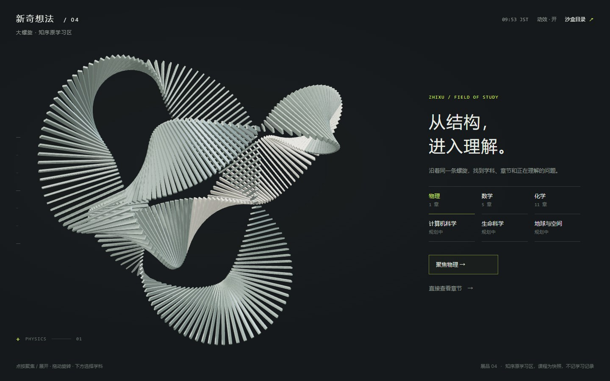
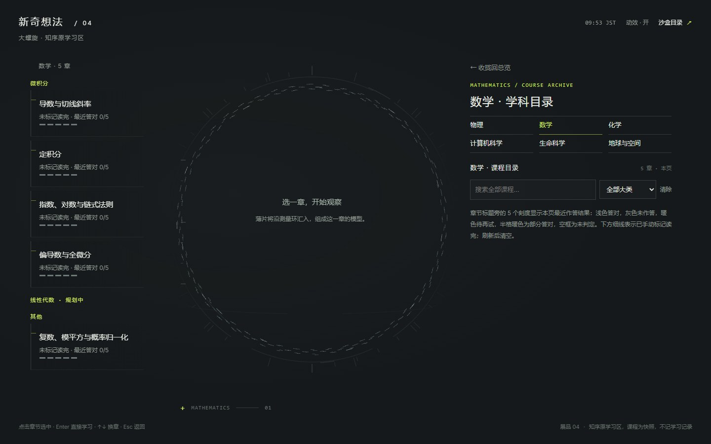
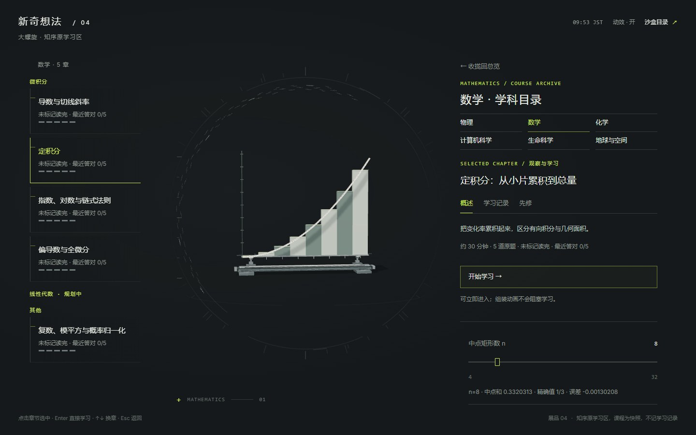

# 展品 04 · 大螺旋（知序原来的学习区）

2026-11-12 · 入口：[`exhibits/spiral/`](../../exhibits/spiral/)。分支 `exhibit/spiral`，还没合进 `main`。

## 这是什么

知序原来的学习区：一条 288 片薄片的螺旋分成六个学科，点一段聚焦，再点一次按章节松开；选一章，薄片沿测量环流到入口、一股股汇进来，组成这一章的观察模型（流星组装）；拖滑杆看结构怎么变，再进去就是课程页（正文、推导讲义、5 道练习）。

**Yank 2026-11-11 定的**：正式站的一楼改成「理解星图」（设计在 `yank-study-lab` 的 `docs/study-stars-design.md`），原来的学习区不再放回正式站；大螺旋这一套搬来新奇想法网站当展品，不丢。怎么拆、带不带课程内容、要不要保留流星组装，由这边定。

## 这边定的三件事

1. **怎么拆：复制成一件自成一体的展品，`laboratory/` 不动。**
   螺旋本来就是在沙盒 `laboratory/`（v40，特蕾莎、露娜）做出来、再接进正式站的，两边的模块几乎一样。展品以 `laboratory/` v40 为底稿复制到 `exhibits/spiral/`，再把正式站接入之后改好的三处带过来（见下一节）。
   不直接把 `laboratory/` 当展品，是因为它是沙盒里的「一楼」：星图的样稿以后要在沙盒做，一楼迟早要动。展品只引用自己目录和 `vendor/three/`，一楼怎么改都不影响它（`check-spiral.mjs` 会查这一条）。
2. **带课程内容：带，用快照。**
   学科 → 章节 → 模型这条线要有章节才成立，每个观察模型也是照那一章的内容配的（定积分的中点矩形、能斯特的两个浓度……）。17 章正文、推导讲义和 85 道题原样留着，是正式站内容在提交 `05be1e3` 时的快照；之后正式站只给数学加了大类，这里补上了。**不记学习记录**：读完标记和作答只在本页，刷新清空。
3. **流星组装：保留。**
   它是从目录走到模型的那段路，去掉就只剩「目录」和「模型」两张静止的画面。早期的独立小样还在 [`preview/meteor/`](../../preview/meteor/)（说明见 [流星组装 · 小样](../laboratory/meteor-assembly.md)），没动。

## 从正式站带过来的改动

正式站接入后在 `src/lab/` 上改过四轮，对展品有用的三处都带了：

| 正式站版本 | 改了什么 | 展品里在哪 |
| --- | --- | --- |
| v3.0.1 | 总览和聚焦时镜头拉近，螺旋大、居中，几乎占满画面（4.4 / 4.6，v40 是 6.8 / 5.8） | `scene.js` 的 `SPIRAL_OVERVIEW_DISTANCE`、`SPIRAL_FOCUS_DISTANCE` |
| v3.0.1 | 螺旋上不再挂「物理 · 聚焦 ↗」的文字标签 | `spiral.css` 末尾 |
| v3.2 | 目录分大类：数学分成微积分、线性代数（规划中）、其他；筛选框按大类筛 | `archive.js`、`course-data.js` 的 `disciplineGroups`、快照里数学方向的 `groups` |

没带的，都是正式站自己的事：学习记录和云同步、区域路由和竖井过渡要的截图、错题页「再练一次」的定位、课程页底部的主线衔接和课程答疑、手机简洁版（v3.3）。

## 文件

`exhibits/spiral/` 共 20 个模块、3 个样式表、1 个页面。除去路径（`../vendor` → `../../vendor`）和版本号（`?v=40` → `?v=1`），和 `laboratory/` 不一样的只有：

- `scene.js`：镜头距离（上表）。
- `archive.js`、`course-data.js`、`course-snapshot.js`：大类（上表）。`archive.js` 是拿正式站 `src/lab/archive.js` 改回普通页面写法得到的，分组逻辑和正式站一字不差。
- `course-workspace.js`、`index.html`：页眉改成「新奇想法 ／ 04」，几处说明文字改成展品的口吻。
- `spiral.css`：就是 `laboratory.css`，改动追加在文件末尾。

其余 14 个模块（配方、积木、材质、粒子场、轨道运动、组装运动……）和 `laboratory/` 完全一样。`laboratory/` 里页面没用到的 `chapters.js`、`motion.js`、`specimen.js` 和 `specimens/` 没有复制。

怎么加学科、加章节、给章节配观察模型，仍然看 [新增学科和章节指南](../laboratory/adding-courses.md) 和 [标本积木与配方](../laboratory/specimen-kit.md)，路径换成 `exhibits/spiral/` 即可。展品是定稿的东西，没打算再加课。

## 哪些是真的，哪些是示意

- **真的**：每个观察模型的几何和读数都是按公式算的（中点和与误差、切线斜率、能斯特电势、势阱波函数……），课程里的原题核对在 `laboratory/` 的检查里逐项对过，展品用的是同一份模块。练习的判题规则和正式站一样（单位换算、容差、多项式比较）。
- **示意**：螺旋本身（三叶结）只是目录的形状，没有数学含义；薄片沿环流动、汇入的路径是动画，不是模拟；有机 3 章没有专属模型，用的是中性的课程档案标本；计算机科学、生命科学、地球与空间三个学科是空的（规划中）。

## 检查

- `npm run check:exhibits` 里加了 `scripts/check-spiral.mjs`：只引用自己目录和 three.js、模块版本号一致、17 章 / 85 题 / 6 个学科、快照和 `laboratory/` 的一致（大类除外）、大类分组和「漏写的归到其他」、每一章都能组装出 288 片、镜头距离和隐藏标签。
- `scripts/check-spiral-browser.mjs`（要浏览器，用法在文件开头）：电脑 1440×900 完整走一遍（螺旋高度占画布六成以上 → 点数学聚焦 → 展开 → 大类小标题和筛选 → 选定积分、等组装完 → 拖滑杆读数变 → 进课程页、5 道练习 → Esc 两次退回、螺旋收拢）；iPad 竖屏触摸；关闭动效加章节直链；没有 WebGL 时的文字目录。
- 2026-11-12 在这台电脑上用 Chrome 跑过，四组都通过，没有脚本错误；截图逐张看过。`npm run check` 全部通过。

## 没做的

- **帧率没量，iPad 真机没验。** 浏览器检查只确认画面对、能走通。
- **手机没专门做。** 沿用 v40 的窄屏布局，能用；正式站 v3.3 的手机简洁版没带（展品按「只做电脑和 iPad」）。
- **没合进 `main`，也就还没发布。** 等 Yank 看过再合。
- 首页卡片上的展品小字、页眉的「大螺旋 · 知序原学习区」是我起的，Yank 想换名字直接说。

## 正式站那边的旧代码

展品做好以后，正式站里只为螺旋学习区服务的是 `src/lab/`（23 个文件）、`src/lab.js`、`src/lab-v3.css`。**删不删、什么时候删由 Yank 定，删之前问他**；这边没有动正式站。

几件容易弄混的事：

- `src/orbit-*.js` 不是螺旋，是旧观星台（第谷体系星图、今日天象），`observatory-scene.js` 还在用。
- `src/lab-effects.js`、`lab-interface.css`、`lab-polish.css` 是更早的「实验舱」（v2.38–v2.39）留下的，螺旋学习区没有引用它们的函数。
- 课程内容不在 `content/`（那里只有 `wolf/chemistry.json`），在 `src/content.js`、`chapters.js`、`foundation-chapters.js`、`depth*.js`、`curriculum.js`。按 `v3-plan.md`，旧课程在正式站继续收着；展品带的是快照，不依赖它们。
- 复习区的「重新作答」「复习对应课程」现在打开的是螺旋学习区的课程页，删之前要先给它们找好去处。
