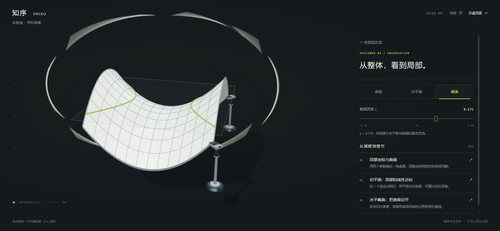

# 大螺旋 · 学科观察 v30

2026-11-03。独立入口：[数学交互范本](https://yankcc258.github.io/test-sandbox/laboratory/?v=30)。本轮仅修改 `test-sandbox`，不修改正式站或原电子环绕开场，不接正式课程、账号接口及学习记录。

## 当前范围

保留实验室的象牙白三叶结薄片、钛金属、深石墨空间和细黄绿线，完善“找到学科 → 观察对象 → 阅读章节 → 返回”的连续流程。首版只开放数学，内容为专门编写的沙盒示例讲义；没有复制正式课程，也没有课程完成度或学习成果计数。

三叶结是学科容器，内部马鞍曲面是独立的数学观察对象，展开动画不表示两者在数学上等价。本轮不扩展生命科学课程，也不制作第四层 Agent 培养室。已有工作台、脊柱复习区、区域过渡与 v29 星图继续保留。

## 体验流程

1. 在总览点按数学薄片、旁边的“数学 · 聚焦”标签或“聚焦数学”按钮，镜头进入局部。
2. 再次点按，薄片展开，显示数学观察对象与章节列表。这是先后两次操作，不要求快速双击。“直接查看章节”可跳过聚焦，直接打开观察和章节。
3. 切换“曲面 / 切平面 / 截面”。拖动模型或使用方向键改变观察方向；切平面和截面模式下可移动取样滑杆。
4. 选择章节，在同一空间阅读。章节会选中对应的观察模式，讲义打开后仍可操作模型、切换模式和调整滑杆；章节列表暂时收起。
5. “返回观察”回到对象与章节列表，保留取样位置；“收拢回总览”关闭观察空间。Esc 按当前阶段返回。中途反向操作改写过渡目标，不积压展开动画。

## 数学对象与示例内容

观察曲面使用 `y = (x² − z²) / 2`，其中 x、z 为水平坐标，y 为高度。

| 模式     | 可观察的内容                                                    |
| -------- | --------------------------------------------------------------- |
| 曲面     | 马鞍曲面及参数网格；可旋转查看整体，滑杆暂不启用。              |
| 切平面   | 选取 `(a, f(a,b), b)` 处的切平面，固定 `b = 0.30`，滑杆调整 a。 |
| 水平截面 | 水平面 `y = c` 与曲面的交线；滑杆调整 `c ∈ [-0.50, 0.50]`。     |

三个原创示例章节为“局部坐标与曲面”“切平面：局部的线性近似”“水平截面：把曲面切开”。公式、数值例子与当前观察对象一致，章节内明确标记“沙盒示例讲义 · 非正式课程”。

## 布局与降级

桌面以左侧模型、右侧同层内容为主，长讲义在内容栏内滚动；手机在上方保留模型，下方连续阅读。屏高至少 600px 时，观察和讲义状态下模型使用吸顶区域；更短的屏幕采用自然滚动，避免模型占去过多阅读空间。界面沿用实验室细线与无大玻璃框的排版。

顶部显示东京时间，并按东京时段轻微调整环境光。动效按钮、系统“减少动态效果”及 `?motion=0` 均可停止自动运动和阶段缓动，手动选择仍可使用。无 WebGL 或 `?view=fallback` 时保留操作按钮、观察说明与全部示例章节，提示立体模型不可用。

本地页面示例：

- `laboratory/?v=30`
- `laboratory/?v=30&motion=0`
- `laboratory/?v=30&view=fallback`

## 文件与检查范围

| 文件                                                 | 用途                                   |
| ---------------------------------------------------- | -------------------------------------- |
| `laboratory/index.html`、`laboratory.css`            | 布局、键盘可达入口与响应式界面。       |
| `laboratory/app.js`、`state.js`                      | 总览、聚焦、观察、讲义状态及东京时段。 |
| `laboratory/scene.js`                                | 三叶结、镜头、展开收拢和输入处理。     |
| `laboratory/specimen.js`                             | 曲面、切平面、水平截线与复用几何。     |
| `laboratory/chapters.js`                             | 三篇原创示例讲义。                     |
| `scripts/check-specimen.mjs`、`check-laboratory.mjs` | 数学几何与流程状态检查。               |

运行 `npm run check:laboratory`，覆盖曲面坐标、切平面导数、截线方程与分支边界、网格有限值及朝向、滑杆几何复用、可逆显示、两次点按流程、直接打开观察、章节返回与取样位置保留、可打断收拢和东京时段边界。该命令已纳入 `npm run check`；本地资源链路另由 `check:links` 检查。

本轮验证：

- `npm run check` 全部通过，包含 `check:laboratory` 和现有回归检查。
- Chrome 实际检查 1536 × 756 桌面、390 × 844 与 320 × 568 响应式布局，无横向溢出。较高手机视口阅读讲义时保留上方模型，568px 短屏采用自然滚动。
- 关闭动效后仍可完成两次进入、返回和键盘旋转；无 WebGL 降级可阅读示例章节。
- 未使用真实手机验证触屏手感或低端设备帧率。浏览器响应式尺寸检查与自动几何、状态检查不代表实体设备性能验收。

## 接入边界

本次新增独立 `laboratory/` 及其检查、目录和交接资料。正式站接入需单独安排，不能把沙盒示例讲义当作正式课程数据直接搬入；原正式学习记录与电子环绕开场不在本轮修改范围。
