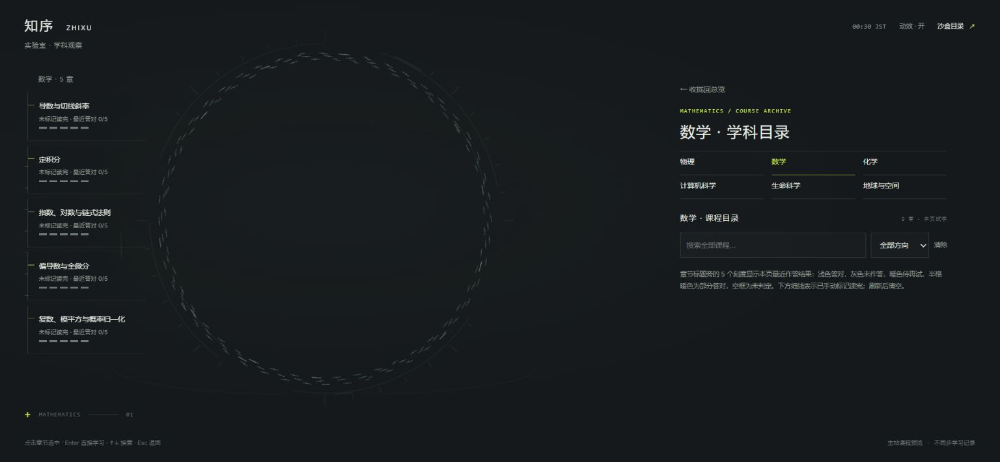
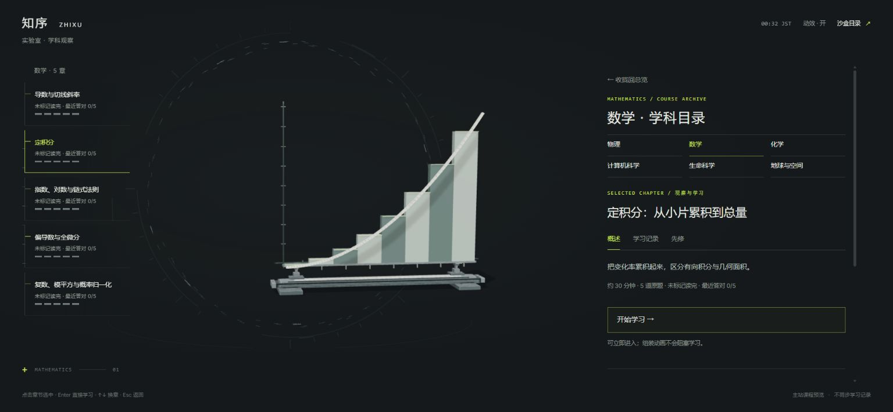
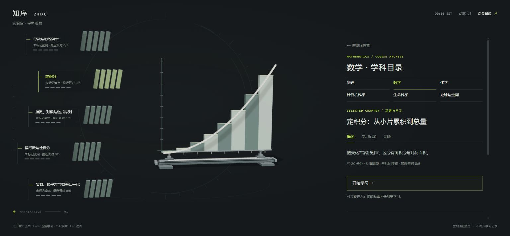
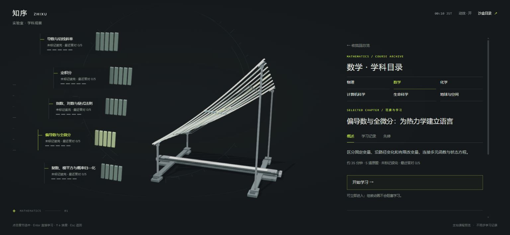
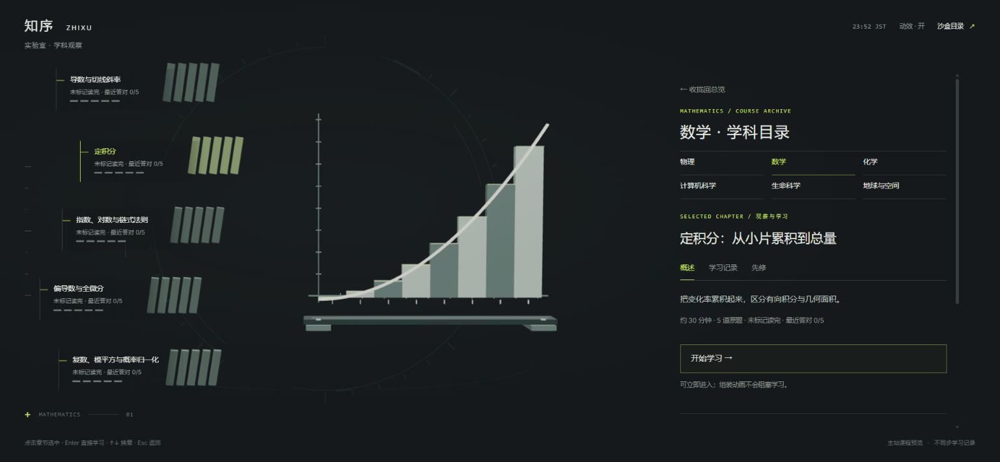
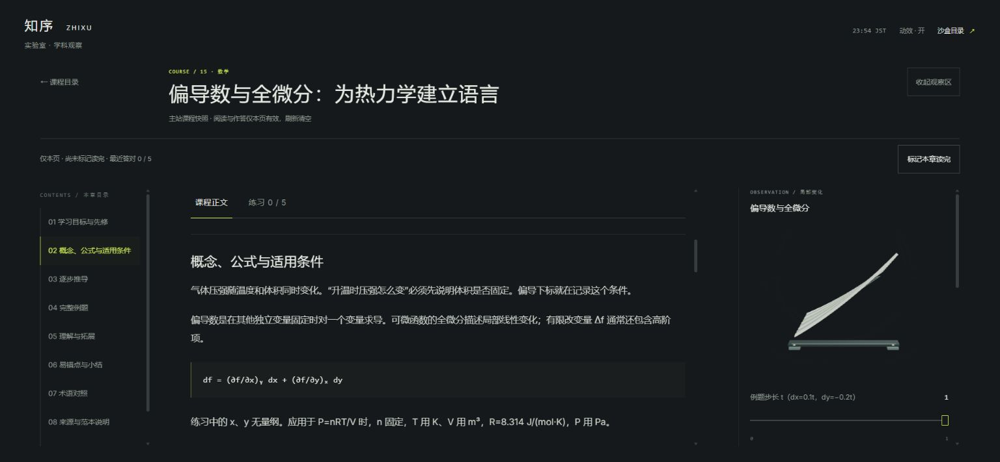

# 大螺旋 · 测量环与流星组装整合 v35

独立入口：[大螺旋观察实验 v35](https://yankcc258.github.io/test-sandbox/laboratory/?v=35)。本轮按用户安排比较并整合露娜流星小样的部分行为，仍只修改 `test-sandbox`；主站、正式学习记录与原电子环绕开场未改。

## 当前交接：v35（2026-11-04 JST）

比对对象是露娜的 [流星组装小样说明](meteor-assembly.md) 与 [独立预览](../preview/meteor/)。小样把展开后的大带子改为沿测量环流动的细针，让薄片先经过同一个入口，再依次搭起观察对象。本轮在现有实验室里采用这套空间组织，保留 v34 已完成的速度连续、材质、阴影与学习衔接。

**协作边界**：`preview/meteor/`、`docs/meteor-assembly.md`、小样截图、露娜原有入口和讨论稿均保留，不修改独立小样。整合发生在现有 `laboratory/`；这里只记录选择与适配，没有把小样整页替换进来。发布前再次同步远端并核对并行修改，不把任何一轮沙盒整体搬入主站。

### 比对后采用与保留的部分

| 对照项目         | v35 处理                                                                                                                                                  |
| ---------------- | --------------------------------------------------------------------------------------------------------------------------------------------------------- |
| 展开后的薄片位置 | 采用沿测量环流动的细针，替代目录旁独立竖起的大带子；测量环继续作为环境参照，不随模型拖动旋转。                                                            |
| 汇入路径         | 采用右上方统一入口：先沿环到入口，再向观察对象汇入，不从环上各处同时直冲中心。                                                                            |
| 构件分派         | 按薄片的预计到达时间分派模型构件，让底座与坐标轴先搭，曲线、曲面或矩形随后落位。                                                                          |
| 飞行与落位形状   | 飞行途中维持细针，最后 `20%` 的落位过程才展开为目标构件，避免长轴或大片面积横穿画面。                                                                     |
| 退回与同章调参   | 无用薄片返回环流；同章参数变化时保留已有构件就地更新，仅新增部分补入、移除部分退回，不重播整套组装。                                                      |
| 运动与质感基础   | 保留 v34 速度连续的 Hermite 过渡、从当前可见位置接续的中断处理，以及象牙白／钛金属材质、精确数学边界和软阴影。                                            |
| 学习与绘制       | 保留立即开课，进入正文和调整布局不重启组装；阅读时停止自动流动与持续绘制，按需响应交互。小样的慢放工具条与无限 `requestAnimationFrame` 循环不搬入实验室。 |

这里采用的是小样的路径与组装组织，收拢、快速换向及换章仍由现有连续运动处理。短尾迹只辅助辨认方向；组装和流动不阻塞正文、作答或返回。

### 题目状态与模型分开

移除三维空间中重复显示的 **85 块题目状态片**。作答状态保留在章节文字旁的 **DOM 刻度**，仍按各章原题与本页最近结果显示。测量环上的细针、组装中的构件和最终模型只负责场景呈现；它们的数量、顺序、亮度或到达情况都不表示答题完成、已读或掌握程度。

### 课程、数据与范围不变

- 课程仍来自主站 [`05be1e3f63e4a81f3e4b52ca37c06d43aeb38b4c`](https://github.com/yankcc258/yank-study-lab/tree/05be1e3f63e4a81f3e4b52ca37c06d43aeb38b4c) 的固定快照：六学科入口，数学、物理、化学已有 **17 章、85 道原题**。正文、原题顺序、提示、解析与评分语义不变。
- 五个数学专属互动继续保留，包括偏导数原算例真实函数 `f=x²y`。其余 12 章的观察物仍是中性档案预览，不代表有机、无机或其他科学模型。
- 草稿、阅读位置、最近判题结果、手动已读标记和访问日志只存在当前页面内存，刷新清空；不接正式账号、云端进度或学习记录。观看动画不计学习成果，读完手动标记，没有假到期或补造历史。
- 本轮没有新增生命科学课程、第四层 Agent 区或其他学科的专属科学模型。主站及其原电子环绕开场未修改。

当前入口使用 `laboratory/?v=35`；关闭动效用 `laboratory/?v=35&motion=0`，无 WebGL 降级用 `laboratory/?v=35&view=fallback`。这些参数不冻结历史版本，独立小样继续使用自己的 [原入口](../preview/meteor/)。

### v35 验证记录（2026-11-04 JST）

- `npm run check` 全部通过，包含既有复习、工作台、转场、星图、课程和资源链接检查；新增轨道与构件映射检查已纳入 `check:laboratory`。
- 轨道测试覆盖 288 个薄片的解析速度、预计到达时间、短角距不越过入口、并入环流与入模段的位置/速度连续、最后 20% 绽开、回环终点连续，以及 30/60/120 Hz 和反复中断。
- 构件测试覆盖一对一分派、参数增减、飞行中调参保留原路线、快速换章、阅读停钟、模型与环流坐标分离、关闭动效和空学科。联调发现并修正了参数更新第一帧的反向速度尖峰，并加入回归用例。
- Chrome 实际检查两次进入、目录环流、偏导/积分/复数之间快速换章、积分矩形数增加到 32 后立即开课、同一画布进入正文和返回。进入正文没有增加组装命令；落位后两次采样的渲染帧计数均为 736，确认停止持续绘制。控制台无意外错误。
- 实际核对一道原题，手动标记读完后返回，目录显示「已读 · 最近答对 1/5」及对应五刻度。化学 11 章可内部滚动和键盘换章；搜索时隐藏左栏，搜索结果可用 Enter 直接进入正文。
- 390 × 844 与 320 × 568 响应式尺寸检查无横向溢出；手机保留单套完整目录，阅读默认收起观察区。关闭动效可直接显示目标模型；320 像素无 WebGL 降级仍可从目录进入原课程。
- 两张 v35 图片来自整合版实际浏览器画面。保留露娜独立小样和原说明，发布前再次 fetch 确认远端基线仍为 `5fe9832`；正式站工作区未修改。未做实体手机帧率验收。

---

> 以下为 v34 及更早阶段的历史记录。“当前”“本轮”指对应版本；旧验证仅对应当时提交，不代表 v35 已通过或已接入主站。历史段落中的预览入口已指向最新 v35，不是冻结旧版本。露娜在 v34 后补充的小样说明原文保留，其采用决定以上方 v35 记录为准。

## 历史归档：v34 运动与观察物精修

独立入口：[当前 v35 入口（下文为 v34 历史记录）](https://yankcc258.github.io/test-sandbox/laboratory/?v=35)。v34 只修改 `test-sandbox`，主站、正式学习记录与原电子环绕开场未改。v33 的课程内容和页面会话继续保留；v34 聚焦展开、流星运动与观察对象的质感。

### 历史交接：v34（2026-11-04 JST）

这一轮让螺旋展开和选章后的组装更自然，并细化观察物的边缘、底座、支撑与连接处，继续统一象牙白、钛金属、深石墨和克制冷光。范围仍是已有 `laboratory/` 沙盒，不扩展课程或正式数据接线。

**协作边界**：Luna 另做独立流星小样，与这一轮已有实验室的调整分别维护；不替换、不覆盖或顺带合入她的小样。讨论稿与 Luna 的文档保持原样。发布前再次 fetch 最新远端，核对并保留并行修改；本说明不代表两个方案已经合并，也不代表接入主站。

> 2026-11-04 · 露娜：Yank 说展开动画不错，但目录状态那条大带子太出戏。露娜做了[流星组装小样](meteor-assembly.md)：`preview/meteor/`，只读复用本目录的 `assembly-models.js`，没改 `laboratory/`，按上面的边界单独维护。小样里展开后薄片沿测量环流动，选章时经入口流进来组装；文档里附了接入建议，要不要用、怎么用由特蕾莎和 Yank 决定。

### 展开与流星运动

- 展开和流星组装采用解析五次曲线，目标改变时保留当前可见位置与速度，从操作发生时的状态继续。展开中收拢、再次展开或快速换章不重新回到起点。
- 路径中的中途偏移连续过渡，避免换目标时突然改向或位置跳变。短尾迹辅助辨认运动方向，不用长光带遮盖观察对象。
- 进入正文、展开观察区或改变窗口尺寸只调整画面布局，不重新启动组装。选章后仍可立即开始学习，不必等待动画结束。
- 关闭动效时直接呈现目标状态，阅读阶段保持静止；目录和观察之间继续复用同一画布。

### 观察对象的材质与连接

| 部位       | 本轮处理                                                                               |
| ---------- | -------------------------------------------------------------------------------------- |
| 象牙白表面 | 按构件角色使用非金属材质，粗糙度 `0.42`、金属度 `0`，保留柔和明暗转折。                |
| 钛金属结构 | 支撑与紧固部件使用粗糙度 `0.44`、金属度 `0.92`，与象牙表面分开控制。                   |
| 边缘与连接 | 结构件加入轻倒角，细化底座、支撑、紧固件及接合关系；用于数学面积的几何仍保留精确边界。 |
| 光影       | 使用 `1024 × 1024` 软阴影，补足承托处和连接处的空间关系，保持克制的冷色环境光。        |

精修针对现有五个数学互动与中性档案构件的显示，不把装饰性支撑解释为公式的一部分，也不因倒角改变数值计算或面积含义。

### 保持的内容与数据边界

- 主站快照仍固定于 [`05be1e3f63e4a81f3e4b52ca37c06d43aeb38b4c`](https://github.com/yankcc258/yank-study-lab/tree/05be1e3f63e4a81f3e4b52ca37c06d43aeb38b4c)：六学科入口中三个已有课程，共 **17 章、85 道原题**。题目顺序、提示、解析和判题语义不变。
- 五个数学互动延续 v33：导数切线、积分中点矩形和、指数与对数、真实 `f=x²y` 的偏导数算例、复数与概率。其余 12 章的观察区域仍为中性档案预览，不代表有机、无机或其他学科的科学模型。
- 目录题目状态细片对应真实原题；观察对象的组装构件另行计数。几何块数、运动轨迹与支撑零件不换算为学习成果。
- 作答草稿、阅读位置、最近结果、手动已读标记和日志只在当前页面内存中保存，刷新清空。读完必须手动标记，日志只记录本页实际动作；没有假到期、假历史或正式掌握率。
- 没有接入正式账号、正式进度、云端记录或后端，也没有新增生命科学课程、其他学科专属科学模型或第四层 Agent 区。

当前预览入口已更新为 `laboratory/?v=35`；关闭动效用 `laboratory/?v=35&motion=0`，无 WebGL 降级用 `laboratory/?v=35&view=fallback`。版本参数只用于缓存更新，不冻结历史画面。

### v34 验证记录（2026-11-04 JST）

- `npm run check` 全部通过，包含 92 个入口及模块链接、原 17 章 / 85 题、独立页面会话、复习、工作台和星图回归。
- 实际运动函数检查了位置、速度与加速度在转折点的连续性，30 / 60 / 120 Hz 采样、32 次快速换向及中断后不重新错峰；参数更新时固定轴与底座保持不动。
- 几何与材质检查覆盖 288 固定实例预算、数学曲线 / 面积 / 概率边界、曲面隔离垫贴合、积分构件不侵入面积、脚垫接触面，以及可见表面与阴影共用精确 / 倒角位置。五个模型最高使用 265 个活动构件。
- 桌面浏览器验证聚焦、展开、快速连续选章，以及组装中立即进入学习。进入正文前后轨迹编号相同，返回目录也不重播；全程一个画布。模型与阴影 shader 实际编译未出现控制台错误。
- 390 × 844 响应式尺寸下无横向溢出；正在组装时调整窗口尺寸，轨迹编号仍保持不变。学习页观察区展开 / 收起、返回目录和关闭动效可用。
- 320 × 568 同时启用无 WebGL 降级及关闭动效：可用键盘进入偏导数课程并完成第一题，正确显示最近答对 1 / 5，无横向溢出。
- 实际浏览器截图已保存：`docs/laboratory-v34-overview.jpg`、`docs/laboratory-v34-detail.jpg`。已恢复测试用的浏览器尺寸覆盖；上述响应式验证不等同于实体手机帧率验收。

---

> 以下为 v33 及更早阶段的历史记录。“当前”“本轮”指对应版本；旧验证仅对应当时提交，不代表后续版本已通过或已接入主站。历史段落中的预览入口已指向最新 v35，不是冻结的旧版本。

## 历史归档：v33 螺旋课程目录

独立入口：[当前 v35 入口（下文为 v33 历史记录）](https://yankcc258.github.io/test-sandbox/laboratory/?v=35)。v33 只修改 `test-sandbox`，不修改主站、正式学习记录或原电子环绕开场。主站课程以固定快照进入沙盒，未接入正式账号或后端。

### 历史交接：v33（2026-11-03 JST）

这一轮把“螺旋展开后进入学习”扩展为完整的课程目录：六个学科入口中，数学、物理、化学有课，共 **17 章、85 道原题**；计算机科学、生命科学、地球与空间仍为规划入口。生命科学没有新增课程。讨论来源仍见 [学科空间与流星组装标本讨论稿](laboratory-proposal.md)，该讨论稿未改写；其中设想不自动等于本轮已经实现的功能。

源数据固定于主站 [`05be1e3f63e4a81f3e4b52ca37c06d43aeb38b4c`](https://github.com/yankcc258/yank-study-lab/tree/05be1e3f63e4a81f3e4b52ca37c06d43aeb38b4c)，不实时同步。读取 `content.js`、`chapters.js`、`foundation-chapters.js`、`curriculum.js`、`course-archive.js`，并保留 12 章在 `depth.js` / `depth-science.js` 中的补充推导。原课程 ID、原题顺序、题目、答案、提示和解析保留，判题采用主站语义。

### 目录、选章与阅读

1. 第一次点按聚焦学科，第二次展开学科目录；也可以直接查看章节。
2. 六学科入口按主站组织，已有课程可按方向筛选或检索。章节详情提供概述、先修和本页访问记录。
3. 选章后，构件沿流星轨迹组装对应观察对象；选中章节时“开始学习”立即可用，组装动画不阻塞阅读。快速换章替换当前目标。
4. 学习工作区保留正文、练习与可折叠观察区；返回目录后保留本页选章、草稿、最近判题结果和阅读位置。
5. 目录状态片用于表达原题的本页结果；观察对象的组装构件另行计数。模型用了多少块几何、多少条轨迹，不代表完成了多少道题。

目录中的细片缓慢流动；进入课程阅读后自动流动停止。背景改为低对比测量环与细刻度，去掉 v32 的暗墙和测量架，延续深石墨、象牙白、钛金属和克制冷光。

### 课程与观察对象的范围

| 学科       | 已有方向                                     | 快照内容                      |
| ---------- | -------------------------------------------- | ----------------------------- |
| 数学       | 数学                                         | 5 章、25 题，五个专属数学互动 |
| 物理       | 经典物理学                                   | 1 章、5 题                    |
| 化学       | 物理化学、有机化学、无机化学                 | 11 章、55 题                  |
| 计算机科学 | 程序设计、数据结构与算法、计算机系统（规划） | 未建设课程                    |
| 生命科学   | 分子生物学、细胞生物学、生物化学（沿用规划） | 未建设课程                    |
| 地球与空间 | 地球系统、行星科学、天文学（规划）           | 未建设课程                    |

数学互动各自对应课程内容，不再用同一个马鞍替代全部章节：

| 数学章节                         | 本轮互动                                                                               |
| -------------------------------- | -------------------------------------------------------------------------------------- |
| 导数与切线斜率                   | `y=x²` 的曲线、移动切点与切线斜率                                                      |
| 定积分：从小片累积到总量         | `y=x²` 在 `[0,1]` 的中点矩形和，改变分片数并对照精确值 `1/3`；明确不是原模型的右端点和 |
| 指数、对数与链式法则             | 指数与自然对数曲线，通过对应点观察互逆关系                                             |
| 偏导数与全微分：为热力学建立语言 | 原算例真实函数 `f=x²y`、`(2,3)` 处的切平面及沿例题步长变化的一阶值、精确值和误差       |
| 复数、模平方与概率归一化         | 复平面向量、模平方权重与归一化概率                                                     |

其余 12 章也能阅读正文和完成原题，但观察区域使用**中性档案构件预览**，没有宣称它们是原子、分子、受力或其他科学模型。原课程模型说明作为文字保留并标注尚未接入；有机、无机等学科的专属科学模型仍待制作。

偏导数原例题中的“原点处”原文保留，紧随阅读注说明它指起始点 `(2,3)`，并非坐标原点。v32 的独立马鞍几何示意保留为历史实现，本轮偏导数观察对象已经与原算例函数对齐。

### 数据与状态边界

- 所有草稿、阅读位置、作答结果、手动阅读标记与访问日志只存在当前页面会话；刷新清空，不连接账号、正式 API 或持久存储。
- “已读”必须由用户手动标记。打开章节、滚动到底、观看动画或答对题目，都不会自动算作读完。
- 每题以最近一次结果显示状态，重复提交不累计题数。修改答案后旧结果失效；数值、单选、多选、填空和表达式沿用原判定含义，无法自动判定显示 `unknown`，不冒充答对或答错。
- 目录展示本页真实作答状态，不生成“到期”“遗忘程度”或正式掌握率。阅读标记和练习结果分开，重置作答不暗中撤销独立的阅读标记。
- 访问日志只记录本页实际查看详情和进入学习的动作，使用东京时间显示；不补造历史，不从悬停或模型运动推算访问。
- 目录题目状态细片与组装模型构件是两套数量：前者对应 85 道原题，后者服务于显示几何。两者不能互相当作学习完成数量。

### 实现位置

| 文件                                                     | v33 职责                                              |
| -------------------------------------------------------- | ----------------------------------------------------- |
| `laboratory/archive.js`、`archive.css`                   | 学科与方向目录、检索、章节详情及状态入口              |
| `laboratory/course-snapshot.js`、`course-data.js`        | 17 章真实快照、六学科五方向、正文适配与全部原题型判定 |
| `laboratory/course-session.js`                           | 各章会话、独立已读标记、最近判题结果与本页访问日志    |
| `laboratory/course-workspace.js`、`course-workspace.css` | 正文、原题、目录往返和观察区                          |
| `laboratory/assembly-models.js`、`assembly-motion.js`    | 五个数学观察对象、中性档案预览与选章组装              |
| `laboratory/scene.js`、`state.js`、`app.js`              | 螺旋目录与课程阶段、镜头、输入和可打断过渡            |
| `laboratory/environment.js`                              | 淡测量环、细刻度与阶段光照                            |

当前预览入口已更新为 `laboratory/?v=35`；关闭动效使用 `laboratory/?v=35&motion=0`，无 WebGL 降级检查使用 `laboratory/?v=35&view=fallback`。查询参数是缓存版本标记，不是冻结的历史版本；旧截图与旧提交才对应当时画面。

### v33 验证记录（2026-11-03 JST）

- `npm run check` 全部通过：脉搏、复习、终端、工作台、90 个入口及模块链接、转场、星图和实验室专项。实验室检查覆盖原课程快照的 17 章 / 85 题、六学科与五方向、全部原文及 12 章补充推导、五类答案、独立课程会话、五个数学模型的计算与几何、可打断组装和直接进入学习。
- 桌面实际浏览器检查通过：聚焦后展开目录、选章组装、快速换章后立即学习、跨学科搜索和方向筛选、键盘连续选择与回车学习。复数章完成 5 / 5，手动标记已读后目录正确显示；填空和表达式题也实际作答验证。练习过程中保持一个画布。
- 390 × 844 响应式视口：无横向溢出，移动端目录可用，观察区默认收起；原生点击从完整例题进入观察案例再返回，段落顶部位置保持 68.3875 px。跨章往返保留练习标签、输入与本章结果，另一章不继承答题数。
- 320 × 568 短屏同时启用 `view=fallback&motion=0`：无横向溢出，仍可进入课程、作答和重置。无立体渲染时内容入口保留。
- 模型组装与参数调节已分开：调参时底座不再重新飞动；阅读时模型静止。桌面最终检查未出现控制台错误。浏览器响应式检查不等同于实体手机性能或帧率验收。
- 本轮实际截图：`docs/laboratory-v33-overview.jpg`（目录与积分模型）、`docs/laboratory-v33-course.jpg`（偏导数宽正文与侧边观察区）。

### 尚未实现与接入约束

本轮没有实现有机／无机等其他学科的专属科学模型，没有把正式账户、云端进度、复习到期或历史学习记录接入沙盒，也没有制作第四层 Agent 区或新增生命科学课程。主站文件与原电子环绕开场未修改。后续接入需保留原课程 ID、原题顺序与原数据契约，不能把沙盒页面会话冒充正式记录。

---

> 以下为 v32 及更早阶段的历史记录。“当前”“本轮”“未接入”均指当时版本，不能覆盖上方 v33 范围。旧验证结果只对应旧提交，不代表 v33 已通过；v33 也未因此接入主站。

## 历史归档：v32 单章课程工作区及 v30 / v31 记录

独立入口：[当前 v35 入口（下文为 v32 历史记录）](https://yankcc258.github.io/test-sandbox/laboratory/?v=35)。本轮仅修改 `test-sandbox`，读取主站一章课程快照用于预览；不修改正式站或原电子环绕开场，不连接账号接口、正式进度或学习记录。v30 / v31 的历史范围与验收保留在下文。

> 2026-11-03 · 露娜回复：学科空间与「流星组装」标本的讨论稿，以及脊柱区大脑与神经递质的待补事项，见 [laboratory-proposal.md](laboratory-proposal.md)。

### 给露娜：当前在测试什么（2026-11-03 JST）

Yank 请我同步这一轮进展。当前重点是**实验室大螺旋展开后，真实学习内容怎样自然进入同一个空间**。我们用主站“偏导数与全微分”一章验证课程容量、阅读与练习衔接，以及观察对象是否真正辅助理解。当前实现提交为 [`45c54e1`](https://github.com/yankcc258/test-sandbox/commit/45c54e1)，当时发布为 v32 预览（上方入口现已更新至 v35）；本条是协作同步，不代表开始接入正式站。

可以沿这条路径试玩：**第一次点击聚焦 → 第二次点击螺旋舒展 → 课程目录 → 偏导数完整正文 → 5 道练习 → 侧边观察与算例 → 返回目录／总览**。“直接查看章节”可以跳过前两次操作。

- **课程容纳方式**：桌面左侧目录、中间宽正文、右侧可折叠观察区；手机以正文为主，观察区默认收起。目录保留主站数学五个单元的真实名称和 ID，本轮只开放 `math-partials`，其余四章明确未接入。
- **真实内容和交互**：使用主站 `05be1e3` 的固定课程快照，不实时同步；完整保留这一章正文、4 道数值题与 1 道多选题，支持提示、判题与解析。阅读／练习／目录之间切换保留本页草稿、最新结果和阅读位置，重复提交不重复计数。观察区复用同一个 canvas。
- **观察与课程的关系**：马鞍曲面用来观察局部、切平面和截面；它不是本章 `f=x²y` 的模型。本章真实算例在旁边独立计算 `df`、`Δf` 和误差，可改 dx、dy 或将步长减半，界面已明确区分。
- **视觉进展**：沿用象牙白、钛金属、深石墨和克制冷光。v31 已精修螺旋舒展与观察物；v32 给总览补暗墙、测量框、刻度和底脚，进入观察／阅读后背景逐步淡退。

接下来主要看：长正文是否舒展，练习与正文来回是否顺手，观察区的帮助是否值得占用空间，以及总览到学习的美术是否连贯。后续是否推广到其他章节、调整观察对象或接入主站，等待 Yank 安排。

**协作边界**：当前仅在 `test-sandbox` 测试，作答保存在页面内存，刷新清空；没有接入正式账号、进度或后端。不要把本轮整个沙盒合入主站，不调整主站原电子环绕开场。生命解剖元素是既有区域的视觉／观察方向，不等于新增生命科学课程；第四层 Agent 区也未在本轮实施。

**已有验证**：`npm run check` 全部通过；Chrome 检查桌面、390 × 844 手机视口及 320 × 568 短屏，覆盖作答、返回、重置、关闭动效和无 WebGL 降级；未做实体手机性能验收。继续开发前先同步 `origin/main`，避免覆盖并行改动。本轮代码集中在 `laboratory/`，详见下方文件表；既有工作台、希可、脊柱和星图的文件未因本轮课程接入而改写。

### 当前范围

保留实验室的象牙白三叶结薄片、钛金属、深石墨空间和细黄绿线，完善“找到学科 → 观察对象 → 阅读与练习 → 返回”的连续流程。v32 开放主站 `math-partials`“偏导数与全微分：为热力学建立语言”这一章的完整内容与 5 道原题。内容固定来自主站提交 [`05be1e3f63e4a81f3e4b52ca37c06d43aeb38b4c` 的 `foundation-chapters.js`](https://github.com/yankcc258/yank-study-lab/blob/05be1e3f63e4a81f3e4b52ca37c06d43aeb38b4c/src/foundation-chapters.js)，不是实时同步课程。

三叶结是学科容器，内部马鞍曲面是独立的数学观察对象，展开动画不表示两者在数学上等价。本轮不扩展生命科学课程，也不制作第四层 Agent 培养室。已有工作台、脊柱复习区、区域过渡与 v29 星图继续保留。

### v32：一章真实内容与页面内练习

数学目录使用主站的五个实际单元名与 ID，只有目标章可进入；其余四章明确为未接入。本轮正文与题目仅从目标章快照读取。

| 单元 ID         | 课程                             | 本轮状态                         |
| --------------- | -------------------------------- | -------------------------------- |
| `math`          | 导数与切线斜率                   | 未接入                           |
| `math-integral` | 定积分：从小片累积到总量         | 未接入                           |
| `math-explog`   | 指数、对数与链式法则             | 未接入                           |
| `math-partials` | 偏导数与全微分：为热力学建立语言 | 正文、原题与观察工作区已接入沙盒 |
| `math-complex`  | 复数、模平方与概率归一化         | 未接入                           |

正文保留原课程的目标、先修检查、推导、例题、路径拓展、易错点、小结、术语与来源。练习保留原题顺序与判题方式，包括 4 道数值题和 1 道多选题；支持无效输入、答错、多选部分正确和答对反馈。

草稿、最新判题结果、阅读/练习位置与观察状态保留在当前页面内。每题只按最新有效结果统计，重复提交不重复累计；修改答案会清除该题过时的判题结果。切回课程目录再进入，可以继续本轮阅读和作答。刷新页面清空这些状态，“重置本轮作答”清空当前答案与统计；没有 API、`localStorage`、`sessionStorage` 或其他持久存储接线，也不影响主站已有记录。

### 实验室环境

新增低对比暗墙、测量架、钛金属轨道、冷光和底脚，为螺旋提供明确的空间参照。环境保持固定，观察对象仍可转动；构件与材质由程序生成。随着展开，背景可见强度降到总览的约 10%；进入课程阅读后进一步降到约 1.8%，让文字和观察物保持清楚。

### 历史：v31 展开与质感精修

薄片保留来自三叶结的连续顺序，沿切向弧线舒展为三条具有前后深度的曲带。各段依次让开观察对象，终态仍能辨认来源结构，形成有节奏、非均匀的空间构图。

展开与收拢使用保留当前速度的可逆阻尼。操作改变目标后从当前运动状态继续，不重新启动整段动画；章节立即可选，进入阅读不必等待曲带停稳。关闭动效仍可直接切换状态。

观察物区分象牙白表面、钛金属边缘与支撑，细化固定件、接合处和表面粗糙度。光照降低填光，保留曲面的明暗转折与结构遮挡，以克制的冷色轮廓光衔接主站实验室和脊柱质感。v31 当时只调整沙盒视觉与运动，仍使用三篇原创示例讲义；v32 的课程内容已按上文更新。

### 体验流程

1. 在总览点按数学薄片、旁边的“数学 · 聚焦”标签或“聚焦数学”按钮，镜头进入局部。
2. 再次点按，薄片展开，显示数学观察对象与章节列表。这是先后两次操作，不要求快速双击。“直接查看章节”可跳过聚焦，直接打开观察和章节。
3. 切换“曲面 / 切平面 / 截面”。拖动模型或使用方向键改变观察方向；切平面和截面模式下可移动取样滑杆。
4. 选择唯一开放的“偏导数与全微分”，进入左目录、宽正文、右观察区的课程工作区。在“课程正文 / 练习”间切换，可阅读全部内容并完成五道题。
5. 使用“收起/展开观察区”调整正文空间；手机默认收起。观察区内可调整几何示意，也可操作本章真实算例的 dx / dy 数值和“步长减半”。
6. “课程目录”返回对象与单元列表，保留页面内阅读位置、草稿与观察参数；“收拢回总览”关闭观察空间。Esc 按当前阶段返回。中途反向操作改写过渡目标，不积压展开动画。

### 几何示意与本章真实算例

观察曲面使用 `y = (x² − z²) / 2`，其中 x、z 为水平坐标，y 为高度。

| 模式     | 可观察的内容                                                    |
| -------- | --------------------------------------------------------------- |
| 曲面     | 马鞍曲面及参数网格；可旋转查看整体，滑杆暂不启用。              |
| 切平面   | 选取 `(a, f(a,b), b)` 处的切平面，固定 `b = 0.30`，滑杆调整 a。 |
| 水平截面 | 水平面 `y = c` 与曲面的交线；滑杆调整 `c ∈ [-0.50, 0.50]`。     |

上方马鞍只用于观察局部曲面、切平面和截面的关系，**不是**本章 `f(x,y) = x²y` 的三维图形。右侧另设独立数值算例：从 `(2,3)` 出发，调整 dx、dy，对比一阶估计 `df = 12dx + 4dy`、精确变化 `Δf = (2+dx)²(3+dy) − 12` 及二者之差。“步长减半”同时缩小 dx 和 dy；这些数值操作不会改变马鞍模型，也不会代填练习答案。

原例 `dx = 0.1`、`dy = −0.2` 对应 `df = 0.4`、`Δf = 0.348`，估计比精确值高 `0.052`。正文保留原文，并补一条阅读注：原文“原点处”在此指本例起始点 `(2,3)`，并非坐标原点。

v30 / v31 的“局部坐标与曲面”“切平面：局部的线性近似”“水平截面：把曲面切开”是早期原创示例稿，不再作为当前课程入口。

### 布局与降级

总览和观察阶段保留螺旋与曲面为主体。进入课程后，桌面使用左侧章节目录、中间宽正文、右侧观察区，正文与侧栏分别滚动；观察区可收起以放宽正文。较窄桌面将目录改为横排。手机以正文为主，观察区默认折叠，主动展开后位于正文前方，页面自然滚动。三维区域迁移同一个 canvas，不另建一套模型。界面沿用实验室细线与无大玻璃框的排版。

顶部显示东京时间，并按东京时段轻微调整环境光。动效按钮、系统“减少动态效果”及 `?motion=0` 均可停止自动运动和阶段缓动，手动选择仍可使用。无 WebGL 或 `?view=fallback` 时提示立体模型不可用，仍保留课程正文、原题与数值算例。

本地页面示例：

- `laboratory/?v=35`
- `laboratory/?v=35&motion=0`
- `laboratory/?v=35&view=fallback`

### 文件与检查范围

| 文件                                                        | 用途                                           |
| ----------------------------------------------------------- | ---------------------------------------------- |
| `laboratory/index.html`、`laboratory.css`                   | 布局、键盘可达入口与响应式界面。               |
| `laboratory/app.js`、`state.js`                             | 总览、聚焦、观察、讲义状态及东京时段。         |
| `laboratory/scene.js`                                       | 三叶结、镜头、展开收拢和输入处理。             |
| `laboratory/motion.js`                                      | 保留速度的展开阻尼与沿曲带的释放次序。         |
| `laboratory/specimen.js`                                    | 曲面、切平面、水平截线与复用几何。             |
| `laboratory/environment.js`                                 | 固定实验室环境、构件与阶段淡退。               |
| `laboratory/course-data.js`                                 | 主站单章快照、真实数学目录与纯判题。           |
| `laboratory/course-session.js`                              | 本页草稿、最新结果统计与真实算例计算。         |
| `laboratory/course-workspace.js`、`course-workspace.css`    | 宽正文工作区、观察区折叠、原题界面及位置保持。 |
| `laboratory/chapters.js`                                    | v30 / v31 三篇原创示例稿，历史文件。           |
| `scripts/check-specimen.mjs`、`check-laboratory.mjs`        | 数学几何与流程状态检查。                       |
| `scripts/check-course-data.mjs`、`check-course-session.mjs` | 课程快照、判题、草稿与算例检查。               |

运行 `npm run check:laboratory`，覆盖曲面坐标、切平面导数、截线方程与分支边界、网格有限值及朝向、滑杆几何复用、可逆显示、两次点按流程、直接打开观察、章节返回与取样位置保留、可打断收拢和东京时段边界。该命令已纳入 `npm run check`；本地资源链路另由 `check:links` 检查。

v32 新增的 `check-course-data.mjs` 校验固定课程快照、正文与五题的内容及顺序、实际五章目录、数值判题容差和多选的部分正确/错误/无效状态；`check-course-session.mjs` 校验草稿隔离、修改答案后清除旧结果、按题唯一计数、重置、新页面空状态及真实算例与步长减半。两项已纳入 `check:laboratory`。下方保留历史验收，v32 最终验证结果单独记录。

#### v32 验证（2026-11-03）

- `npm run check` 全部通过，覆盖现有复习、工作台、转场、星图与链接回归；`check:laboratory` 包含课程快照一致性、四道数值题与多选题判定、修改草稿清除旧结果、按题唯一计数、页面隔离与真实算例误差计算。
- Chrome 实际走通桌面两次进入、课程正文、目录跳转、5 题作答、错误与漏选反馈、全部答对、观察区开合与步长减半；未出现脚本错误。
- 手机 390 × 844 阅读时默认收起观察区；从正文进入练习、展开算例并返回，原例题段落恢复到相同位置（68px 与 67.8px）。正文和练习标签在阅读中吸顶，算例另有返回原位置按钮。
- 320 × 568 检查无横向溢出；无 WebGL 且关闭动效时仍可进入正文、作答和重置。未做实体手机帧率验收。
- 背景墙面与地面在画布边缘渐隐，避免画布右边出现矩形色块；沿用同一个渲染器和按需动画循环。

#### v31 历史验证（2026-11-03）

- `npm run check` 全部通过；新增 30 / 60 / 120 步每秒的运动一致性、反向连续与最终收敛检查，以及接触垫贴合曲面、球座连接承托的几何检查。
- Chrome 检查桌面与 390 × 844 手机视口，覆盖两次进入、连续展开/收拢/再展开、切平面与截面、讲义返回和关闭动效，未出现脚本错误或横向溢出。
- 保持单个按需动画循环，运动完成后停止绘制；未做实体手机帧率验收。
- 材质和几何均为原创程序生成，未增加外部资产或依赖。正式站工作区未修改。

#### v30 历史验收（2026-11-03）

以下为 v30 的已完成验收，保留用于回看初版范围。

- `npm run check` 全部通过，包含 `check:laboratory` 和现有回归检查。
- Chrome 实际检查 1536 × 756 桌面、390 × 844 与 320 × 568 响应式布局，无横向溢出。较高手机视口阅读讲义时保留上方模型，568px 短屏采用自然滚动。
- 关闭动效后仍可完成两次进入、返回和键盘旋转；无 WebGL 降级可阅读示例章节。
- 未使用真实手机验证触屏手感或低端设备帧率。浏览器响应式尺寸检查与自动几何、状态检查不代表实体设备性能验收。

### 历史：v31 正式学习内容讨论

以下记录的是 v31 的设计讨论。v32 已在沙盒落实 `math-partials` 一章、宽正文、目录、可折叠观察区和页面内位置保持；其余四个数学单元、其他学科以及正式数据接线仍未接入，不能将下文所有建议理解为当前功能。

当时依据正式仓库 `origin/main` 的 `05be1e3` 快照讨论。该版本有 17 个学习单元、85 道题，分为数学 5 单元、物理 1 单元、化学 11 单元。学科组织见 [course-archive.js](https://github.com/yankcc258/yank-study-lab/blob/05be1e3/src/course-archive.js)，单元归属见 [curriculum.js](https://github.com/yankcc258/yank-study-lab/blob/05be1e3/src/curriculum.js)，阅读、答题与进度管理见 [app.js](https://github.com/yankcc258/yank-study-lab/blob/05be1e3/src/app.js)。v31 尚未接入这些课程内容。

正式数学的五个单元并非当时三篇示例讲义。马鞍曲面适合“偏导数与全微分”这一章的局部观察，不应成为全部数学课程的统一模型。

| 正式数学单元       | v31 讨论中的观察方式                |
| ------------------ | ----------------------------------- |
| 导数与切线         | 函数曲线、移动切点与切线。          |
| 定积分             | 曲线下的面积与矩形累积。            |
| 指数对数与链式法则 | 指数/对数曲线与复合函数的变化关系。 |
| 偏导数与全微分     | 当前马鞍曲面、切平面及局部变化。    |
| 复数与概率归一化   | 复平面与归一化前后的概率权重。      |

建议将正式流程组织成“螺旋展开学科工作区”：学科目录在同层展开，选章后更换与该章相关的观察对象。适合图形、公式推导或解题的内容就使用这些形式，没有必要为每道题强制配一个三维模型。

进入讲义时，以正文占主宽，观察区可以折叠；需要对照时再展开。目录、观察、讲义之间返回应保留阅读位置、所选章节及当前观察参数。这样长正文、题目和多种观察形式可以共存，不受当前单一马鞍示例的布局约束。

若后续获准接入主站，应保留正式课程 ID、题目顺序、既有进度和后端数据契约，改动集中在呈现与导航。以上是 v31 的讨论记录；v32 的实际范围以上文当前说明为准，正式站尚未修改。

### 接入边界

`laboratory/` 是 v30 新增、v31 精修、v32 试接单章课程的独立沙盒区域，连同其检查、目录和交接资料单独维护。当前保留 `math-partials` 原 ID、原题顺序和判题语义，但页面内练习状态与主站数据完全分开；正式站接入及其进度、后端仍需单独安排。原正式学习记录与电子环绕开场不在本轮修改范围。
