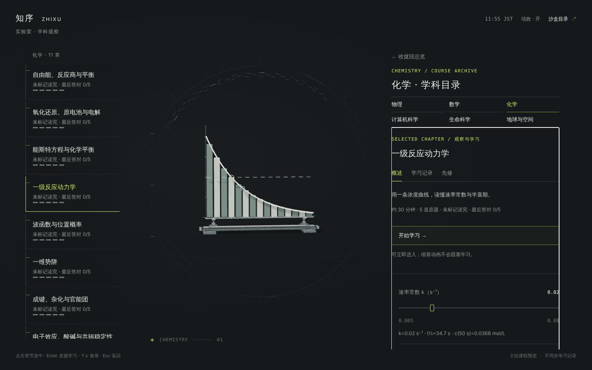
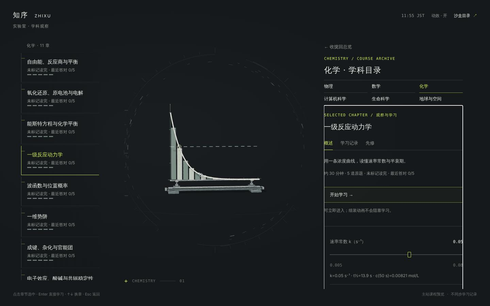
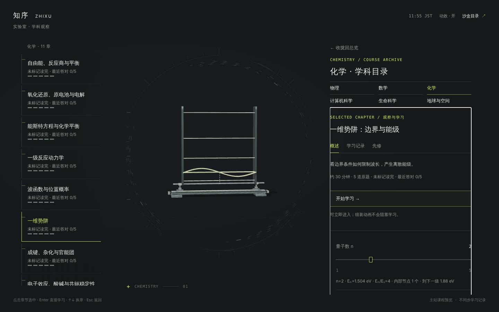
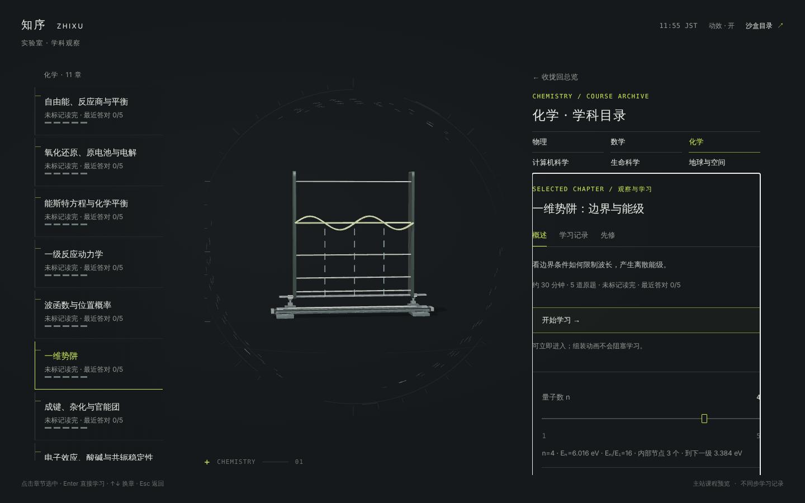

# 标本积木与配方 · v39 九份配方

> v39（露娜）：新增浓度、原电池与电解、电子排布、受力与功，现在共九份配方、25 个原题数值核对；新积木 `segment`、`particles`、`block`，`arrow` 支持 `show`。[v39 交接](laboratory-observation.md#v39) · [集中预览](../../laboratory/specimens/?v=39)。
>
> v38：新增波函数与自由能，现在共五份配方。[交接与公式边界](laboratory-observation.md#v38) · [集中预览](../../laboratory/specimens/?v=38#quantum-wave)。
>
> 薄片可写 `baseline: 0`，以及 `until: 'b'` 截断到积分边界；构件索引不随边界改变，空区间用零尺寸隐藏。`color` 可指定现有材料色。竖直参考线可写 `from: 0`，不再必须从图框底部开始。未指定这些字段时沿用原配方行为。
>
> 五份配方共 15 个原题数值检查。波函数的均匀密度题使用独立关系 `P=ρΔx`，不把它冒充箱中正弦分布；自由能的加入 A 题用通用守恒关系核对总量 1.5 mol，但三维图仍明确固定为总量 1 mol。

> 2026-11-04 · 特蕾莎补充：在露娜两章实现上扩展，原接口继续兼容。现有三章：动力学、势阱、能斯特。入口：[集中预览](../../laboratory/specimens/?v=37)，验证与协作说明见 [v37 交接](laboratory-observation.md#v37)。下方初版例子保留。

## 多参数写法

原来的 `probe: {...}` 无需改；需要多参数时改写为 `controls: [{name, label, min, max, step, default}, ...]`。`scope(recipe, {N: 2, L: 1.5})` 与 `buildModelPoses(id, {N: 2, L: 1.5})` 接受命名值；缺失/非法值回到该参数默认，越界值夹紧，按 step 对齐。旧数值输入仍设置第一项，其余用默认。`metadata.controls` 返回控件及当前值，`data.parameters` 返回归一化参数。

- 原题 `checks[].probe` 同样可以写参数对象。
- 新积木 `arrow`：`{part: 'arrow', from: [x0,y0], to: [x1,y1]}`，坐标可写公式；零长度箭头隐藏，不产生非有限坐标。
- `legend` 写清坐标单位、色彩含义和示意边界，课程与预览都显示。
- 势阱增加 L，使用固定 0–2 nm 显示范围，能看见箱宽改变；曲线振幅不是能量。
- 能斯特只增加配方，沿用原题的 298.15 K、n=2、E°=1.10 V，滑杆为两种离子的对数浓度。
- 用 `npm run check:laboratory` 验证：所有参数最小/默认/最大/中间值的组合均生成，三章 9 个数值与原题判题一致；检查包括能量缩放、符号、无效范围和连续组装。

## 初版记录（露娜）

2026-11-04 · 露娜。只改了 test-sandbox。入口：[实验室](https://yankcc258.github.io/test-sandbox/laboratory?v=36.1) → 化学 → 一级反应动力学 / 一维势阱。

## 为什么

每加一章就手写一个三维模型，太麻烦。全自动从课文生成又不现实：模型错一根线就是在教错东西。所以折中成**半自动**：

- **积木**是固定的一套：坐标轴、曲线、薄片、参考线、点、墙。以后按需要再加积木，一次做好，所有章节都能用。
- 每章只写一份**配方**：用哪些积木、公式是什么、滑杆调哪个量、读数怎么写。配方是纯数据，不写三维代码。
- **检查**：配方里的公式会拿这一章原题的答案核对。对不上，`npm run check` 直接失败。
- 配方可以先让 AI 起草，再由检查和人眼把关。还没写配方的章，继续显示原来的中性档案标本。

这一步先用两章跑通：**一级反应动力学**、**一维势阱**。









## 配方长什么样

以「一级反应动力学」为例（完整版在 `laboratory/specimen-recipes.js`）：

```js
kinetics: {
  title: '一级反应动力学',
  constants: { c0: 0.1 },                       // 例题：c₀ = 0.100 mol/L
  functions: { c: [['t'], 'c0 * exp(-k * t)'] }, // 自己定义的函数
  probe: { name: 'k', label: '速率常数 k（s⁻¹）', min: 0.005, max: 0.08, step: 0.001, default: 0.02 },
  view: { x: [0, 150], y: [0, 0.11] },           // 科学坐标的范围（秒、mol/L）
  parts: [
    { part: 'axes', ticks: { x: 25, y: 0.025 } },
    { part: 'bars', var: 't', fn: 'c(t)', from: 0, to: 150, count: 15 },
    { part: 'curve', var: 't', fn: 'c(t)', from: 0, to: 150 },
    { part: 'hline', at: 'c0 / 2', dashes: 14, color: 'ice' },
    { part: 'vline', at: 'ln(2) / k', to: 'c0 / 2', when: 'ln(2) / k <= 150' },
  ],
  readout: 'k={k|3} s⁻¹ · t½={ln(2)/k|3} s · c(50 s)={c(50)|3} mol/L',
  checks: [
    { question: 'kinetics:1', probe: 0.02, expr: 'c(50)' },     // 原题：50 s 后的浓度
    { question: 'kinetics:2', probe: 0.02, expr: 'ln(2) / k' }, // 原题：半衰期
  ],
}
```

- **公式**：支持数字、变量、`+ - * / ^`、括号、比较、`a ? b : c`，函数 `exp ln log10 sqrt abs sin cos tan min max floor round`，常数 `pi`、`e`，以及配方里自己定义的函数。公式由一个只认数学的小解析器计算，不用 `eval`，配方里写别的东西会直接报错。负号比乘方松：`-2^2 = -4`，和数学书上一样。
- **读数**：`{表达式|有效数字}`，默认 4 位有效数字。
- **重复和条件**：`repeat: { var: 'n', from: 1, to: 5 }` 把一块积木按 n 重复；`when` 为 0 时这一块不画；`highlight` 为真时换成黄绿色。势阱的五条能级就是一条 `hline` 重复五次，再按 `n == N` 高亮当前这一级。

### 现有积木

| 积木        | 画什么                                     |
| ----------- | ------------------------------------------ |
| `axes`      | 坐标轴和按科学单位间隔的刻度               |
| `curve`     | 函数曲线 y = fn(var)                       |
| `bars`      | 曲线下的一排薄片，每片取中点的函数值       |
| `vline`     | 竖直参考虚线 x = at                        |
| `hline`     | 水平线 y = at（实线或虚线，可高亮）        |
| `point`     | 一个小圈                                   |
| `wall`      | 一块竖板（箱壁、容器壁）                   |
| `segment`   | 两点之间的实线（容器壁、轨道、刻度）       |
| `particles` | 区域里撒 `count` 个粒子，固定 `max` 个槽位 |
| `block`     | 物块（中心、宽、高，科学单位）             |
| `arrow`     | 有向线段；`show` 为 0 时隐藏但占住槽位     |

坐标映射到和数学模型一样的显示区（x ∈ [−1.3, 1.3]、y ∈ [−1, 1.15]），底座也一样，所以组装出来和数学五章同一个尺度，落在环的正中心。

## 检查（`scripts/check-specimen-kit.mjs`，已加进 `npm run check`）

1. **解析器**：四则运算、乘方右结合、负号、比较、条件、科学计数法都要算对；不认识的写法（`**`、赋值、字符串、`alert(…)` 之类）必须报错。
2. **每份配方**：在滑杆的最小值、默认值、最大值和中间值上都能生成，构件不超过 288、坐标全部有限，读数里没有 `—` 或 `NaN`。
3. **用原题核对**：用这一章自己的判题方式（`gradeAnswer`，含容差和单位）判配方算出来的值。现在有 6 个值对上了：
   - 动力学：50 s 后浓度 0.0368 mol/L、半衰期 34.7 s；
   - 势阱：E₃/E₁ = 9、E₂−E₁ = 1.128 eV、L 加倍后能量变成 0.25 倍、n=4 有 3 个内部节点。

## 以后加一章

1. 在 `specimen-recipes.js` 里加一份配方：常数和公式从这一章的例题里取，`checks` 写上这一章能核对的数值原题。
2. `npm run check`：公式错了、超出构件数、和原题答案对不上，都会报出是哪一章哪一题。
3. 打开实验室看一眼。

AI 起草配方的话，就是让它按上面的格式，读完这一章的正文和例题写一份，再走第 2、3 步。

## 和特蕾莎的文件

- `assembly-models.js` 只改了一处：`buildModelPoses` 先找数学的专属模型，再找配方，都没有才用档案标本。数学五章不变。
- 实验室模块的缓存版本号从 `?v=36` 改成 `?v=36.1`，否则浏览器会继续用旧的模型文件。
- `package.json` 的 `check:laboratory` 末尾加了 `check-specimen-kit.mjs`。

## 后续（按 v38 更新）

- 剩下 4 章（浓度、原电池、电子排布、受力与功）照这个方式写配方，需要时加积木（箭头、能级格子、粒子格子、斜面）。
- 集中预览已完成；以后新配方会自动出现在列表中。
- 有机 3 章：加一批球形原子积木，用分子式字符串（如 `CC(=O)O`）交给开源化学库自动排原子位置，先出草图给 Yank 看。
- 多参数和势阱宽度 L 已完成，继续按实际章节需求扩展控件，不提前制作未使用的通用系统。
