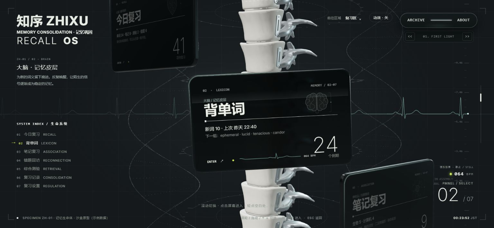

# 记忆生命体 · 系统设定与点击定拍

在已确认的脊柱模型上，把七个复习入口描述为同一个合成生命体的不同系统。维持冷静、疏离的观察台气质：低亮度单色结构图、标本编号、简短描述。功能名称和复习数量仍然优先可见。

| 入口 | 生物设定 | 作用描述 |
| --- | --- | --- |
| 今日复习 | 心脏 · 循环维持 | 让今日的记忆重新进入循环 |
| 背单词 | 大脑 · 记忆皮层 | 为新的词义留下稳定痕迹 |
| 笔记复习 | 神经丛 · 关联路径 | 把孤立知识接入可抵达的路径 |
| 错题回访 | 修复组织 · 断点再连接 | 定位失效连接，再让信号通过 |
| 综合测验 | 感知系统 · 反应校验 | 输入新的刺激，观察独立回应 |
| 复习记录 | 细胞谱系 · 生长档案 | 保存巩固过程留下的变化 |
| 复习设置 | 内分泌 · 稳态调节 | 调节负荷、间隔与恢复 |

这些是界面叙事隐喻，结构图为原创示意，不是医学解剖模型。`recall-specimen.js` 统一保存设定与绘图；图案绘入现有玻璃屏幕，左侧说明和进入后的内容标题同步标注。

## 点击与心电图

之前根据三秒内的点击总数提高目标心率。这一版根据连续有效点击的间隔定拍：

- 每次有效点击从 QRS 波群前方重新起拍，给出可见脉冲；背景心电图、屏幕内小心电图及脉搏读数共用同一个节律。
- 最近五个间隔取中位数，目标为 `60 / 间隔秒数`，范围为 48–180 BPM。心率平滑靠近节拍，避免偶发一次快点造成突变。
- 停止点击 2.2 秒后逐渐解除跟随，恢复 64 BPM。较长停顿之后重新学习节律。
- 总览中的主指针单击和入口按钮可定拍。拖动、右键、取消的手势、次指针、内容页、音乐及关于页不计入；关闭动效或减少动态效果时保持静止。
- 高频刺激的原有过载彩蛋保留，但要求三秒内至少九次有效点击且达到既有心率阈值，正常慢点不触发。
- 点击间隔使用真实事件时钟；波形扫描采用带余数的固定像素速度，避免高刷新率下改变扫描速度。

页面将读数明确标为“模拟脉搏”，显示静息、脉冲、跟随、恢复状态。没有读取用户生理数据。

## 验证

`npm run check:pulse` 覆盖 48/60/120 BPM 定拍、点击后 100 ms 内的波峰、抖动容错、停止恢复、内容页锁定、过载恢复，以及单击/拖动/右键/控件过滤。

浏览器检查：七个入口说明切换、大脑内容页、单词翻面、实际点击进入 SYNC 状态、手机排版及控制台错误。窄屏把胶囊导航放到品牌下方，分开标本说明和脉搏读数，底部入口改为三列，避免相互遮挡。

本轮只修改独立 `test-sandbox`。脊柱模型、材质配色、原有复习内容和冻结的历史预览保留。
