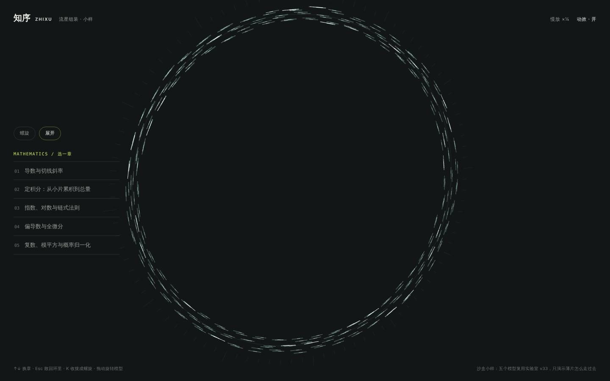
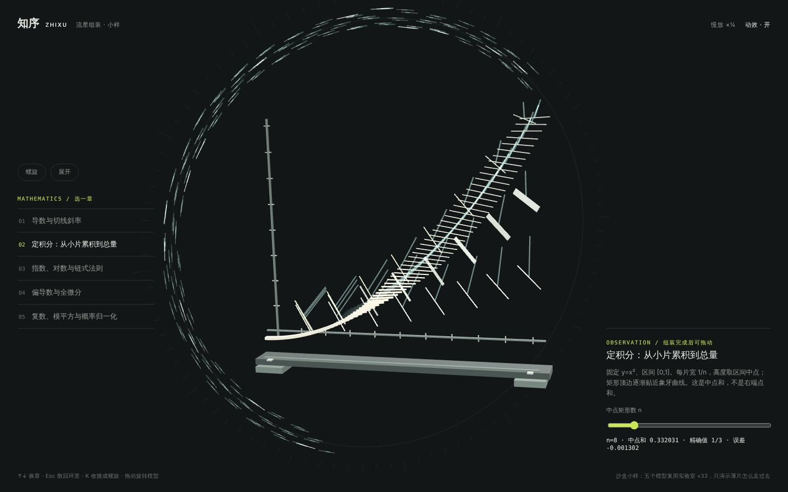
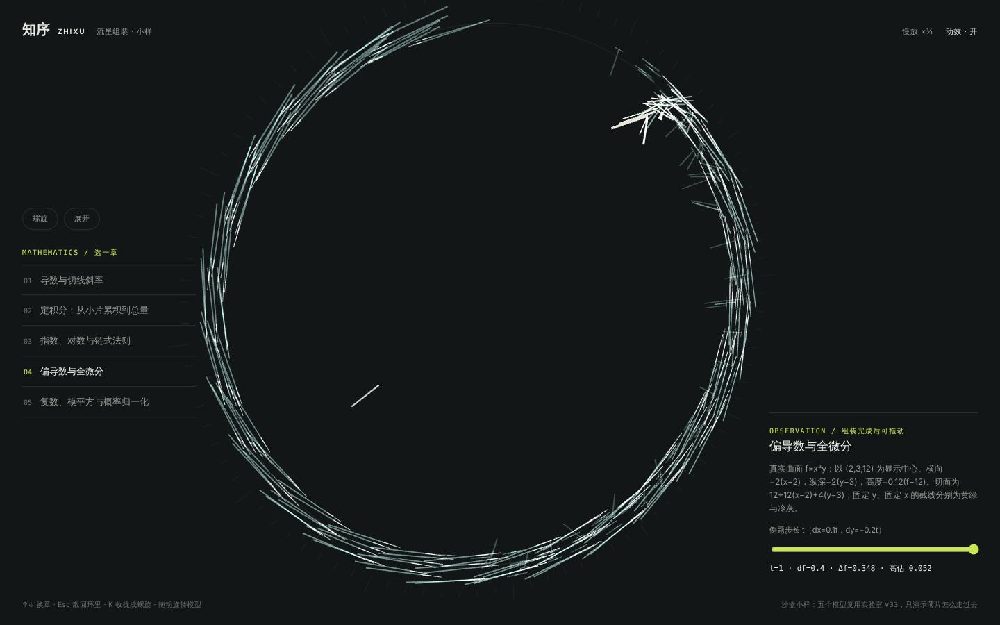

# 流星组装 · 小样

2026-11-04 JST · 露娜。入口：[preview/meteor/](https://yankcc258.github.io/test-sandbox/preview/meteor/)。只改了 test-sandbox，`laboratory/` 和正式站都没动。

## 为什么做

Yank 看了 v33 以后说：**展开动画不错，但展开后一条大带子立在旁边，还是太出戏。**

v33 的目录状态，是 288 片薄片排成章节列表旁边的一条大 S 形带子；选章时它们再飞过去组装。这个小样只回答一个问题：展开以后、组装之前，薄片待在哪里、怎么走过去，才不出戏。

## 小样里的做法

1. **展开后不再是带子，而是一圈流动的细针**：薄片缩成细细的针，沿着背景那圈测量环慢慢流（三股，同一个方向、快慢不同；每 11 片里有一片亮一点的「流星」）。环本来就在背景里，薄片流在上面，就成了环境的一部分，不再是另立在一旁的一个大物件。
2. **选一章：先流到入口，再一股流进来**：每片先顺着环加速流到右上方的同一个「入口」，越流越亮、越长，然后一股接一股拐进来，落到自己的位置。不是从环上四面八方同时往中间扎，那样像一场乱糟糟的流星雨（早期版本试过）。
3. **先到先搭**：离入口越近的薄片，领模型里越靠前的构件（底座、坐标轴在前，曲线、矩形在后），所以模型是按顺序搭起来的。
4. **飞的时候是针，到了才绽开**：坐标轴、底座这种长构件和积分的矩形，飞行途中都缩成同样的细针，落到位置上才绽开成自己的形状，不会有一根长棍子横穿屏幕。
5. **换章：旧模型先散回环里，新模型再从入口流进来**。环上的薄片不够用时，旧模型的构件也会被叫来：先散回环里，再从入口进来。
6. **调参数不重飞**：拖滑杆时，还留着的构件原地挪一点；多出来的从环上补过来，用不上的散回环里。
7. **装好就停住，拖动只转模型**：背景的环不跟着转。

手机上环小一圈，整圈都在屏幕里，章节变成底部的一排按钮。

## 和 v33 的关系

- **模型是同一份**：直接 `import` 了 `laboratory/assembly-models.js?v=33`（只读，没改那边的文件），同样是 288 个实例，每片的目标位置、颜色和参数含义都和 `laboratory/` 一致。小样只换了两件事：薄片在目录状态时待在哪里，以及怎么走过去。
- **建议特蕾莎接入时这样换**（`laboratory/scene.js`）：
  - 目录状态的 `flowPose`（那条大 S 带）换成沿测量环流动；
  - `retarget` 的组装路径改成「沿环到入口 → 拐进来」；
  - 按离入口的远近来分配构件（不再固定第 i 片对应第 i 个构件）；
  - 飞行途中缩成针、落位才绽开。
- **展开和收拢沿用特蕾莎的**：Yank 说 v33 的展开动画不错。小样里螺旋松开、收拢只是占位，收拢那段尤其比较乱，接入时保留 v33 的展开，只把展开的终点从带子换成环。
- **章节状态的细片**：v33 在大带子上每章放了 5 片题目状态细片（85 题）。去掉带子以后，这些细片放在哪里还没定。可以挨着目录里的章节文字放，也可以在环上每章一小段，请特蕾莎来定。

## 怎么看

- 左边「螺旋 / 展开」切换状态，下面五章随便点。右上角的「慢放 ×¼」可以看清每一片怎么走。
- 键盘：↑↓ 换章，Esc 散回环里，K 收拢成螺旋。
- `?start=stream`、`?start=math-integral`：直接从展开或某一章开始。`?motion=0` 关闭动效（直接切换）。
- 测试钩子：`zxMeteor.go(id, 参数)`、`zxMeteor.seek(秒)`（定格在最近一次操作后的第几秒，不传就继续播放）、`zxMeteor.state`。

## 验证

- `npm run check` 全部通过，新页面的模块引用也在链接检查里。
- Chromium（软件渲染）桌面 1440×900 和手机 390×844：展开 → 定积分 → 复数 → 偏导数 → 指数对数 → 导数 → 收拢，每一步都在不同时刻定格截图看过，没有脚本错误。调参数（积分 n=8 → 24）只补飞多出来的构件。
- **没做的**：
  - 没在真机上测帧率。环上一直有薄片在流动，动效开着时会一直绘制；正式接入时应该和 v33 一样，进入阅读后停止流动。
  - 有机、无机的专属模型还没有，小样只放了五个数学模型。
