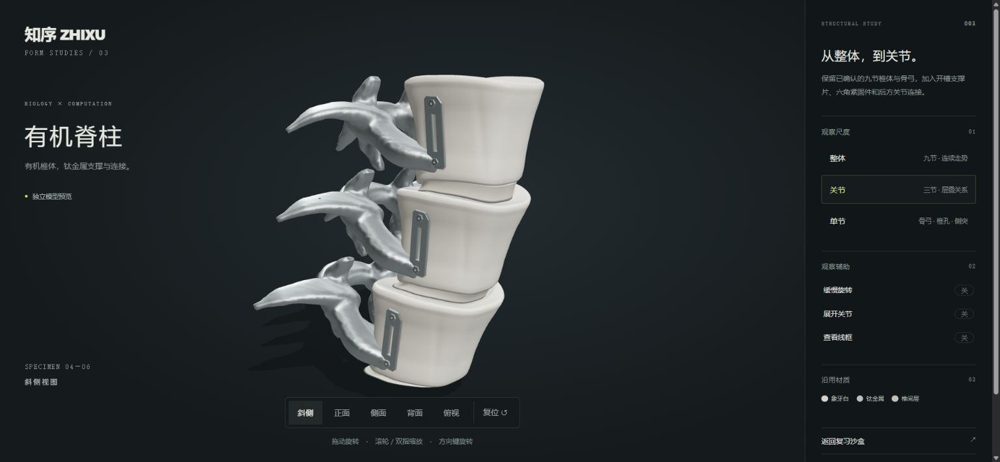

# 有机脊柱第三稿 · 金属装饰与沙盒接入

本轮得到用户明确授权：在已确认的第二稿上加无机金属骨架装饰，推送独立 `test-sandbox` 并替换模型。未修改知序正式项目。




## 造型

- 椎体、骨弓和关节的高精度顶点、法线、索引与已确认第二稿逐字节一致。验证指纹保存在 `scripts/spine/approved-v2.json`。
- 新增侧面开槽支撑片、空心六角紧固件、后方小型支架和轴套。支撑片保留直线和切角，贴合椎体侧壁；不跨越椎孔，也不包裹整个椎体。
- 新零件复用既有钛金属材质。既有象牙白 `#d6d3ca`、钛金属 `#b9c0c2`、椎间层 `#c4c1b8` 及材质参数保留。

## 接入

- 根页面：`models/sculpted-spine.js` 加载 `assets/models/organic-spine-scene-v3.glb`。73 节椎骨沿连续曲线排列，九种轮廓按 0→8→1 往返渐变，避免首尾型号跳变；每处椎间层按真实相邻姿态离线生成。
- 运行模型约 2.56 MiB、430,046 个三角形，复用部件实例化。未把九节高精度模型反复复制到场景。
- 独立旋转预览：`preview/organic-spine/`，加载约 16.23 MiB 高精度 GLB，提供下载。
- 原来的 DNA、脊髓、扫描环、心跳响应、镜头、屏幕、复习示例和音乐保留。JS/CSS 入口统一升级为 `v=9`。
- 模型异步加载，不阻塞导航；加载时有文字提示，不先显示旧模型。关闭动效时，加载完成仍主动补画一帧；失败时提示刷新，复习入口可继续使用。
- 旧原型在 Git 历史以及 `preview/round-0`、`preview/round-1` 中保留。

## 构建与验证

```sh
npm ci
npm run build:models
npm run check:models
```

`scripts/spine/` 包含原创几何生成、金属装饰、离线减面和长链关节拟合脚本。临时生成文件位于被 Git 忽略的 `scripts/spine/generated/`。浏览器运行不需要 npm、外部 CDN 或解码器。

验证检查 GLB 结构、缓冲边界、顶点/法线、索引、姿态、材质一致性、已确认第二稿指纹，以及场景下载量和三角形预算。

本地浏览器验证通过：启用/关闭动效时的模型加载、前后入口切换、背单词进入/翻面/评分/返回、ARCHIVE 回顶、关于页开关；独立模型的关节/单节与背面视图，以及窄屏无横向溢出。所检查页面无控制台报错。完整构建可重现已确认第二稿的几何指纹。真机帧率仍取决于设备与透射玻璃渲染成本，没有据此承诺固定帧率。

减面使用 [meshoptimizer](https://github.com/zeux/meshoptimizer) 的官方 JavaScript/WASM 模块（MIT，仅构建期）。所有造型及装饰为本项目原创；未使用参考站代码、模型、贴图或着色器。
