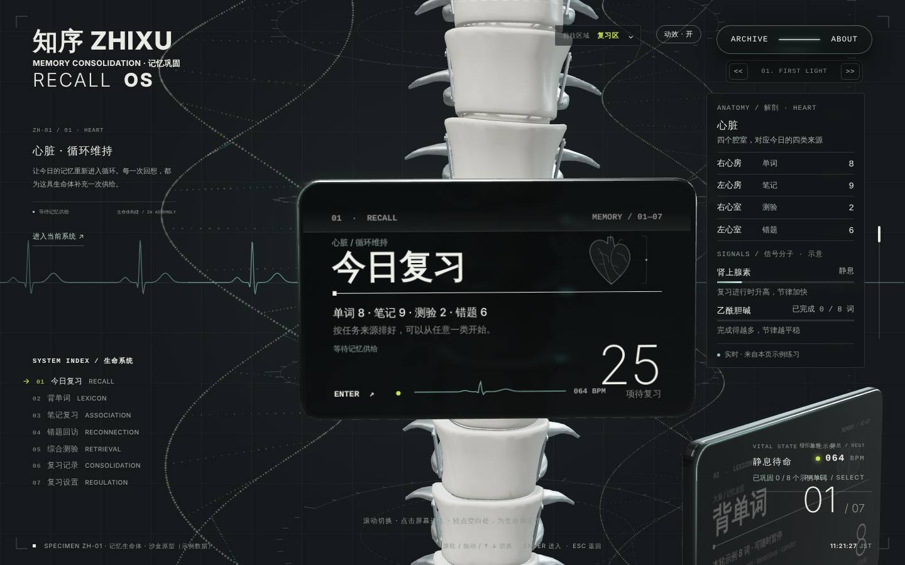
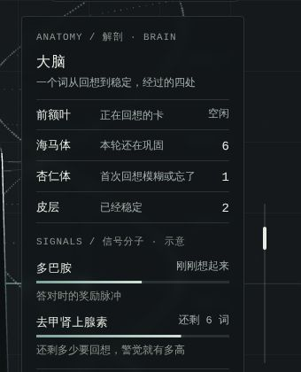
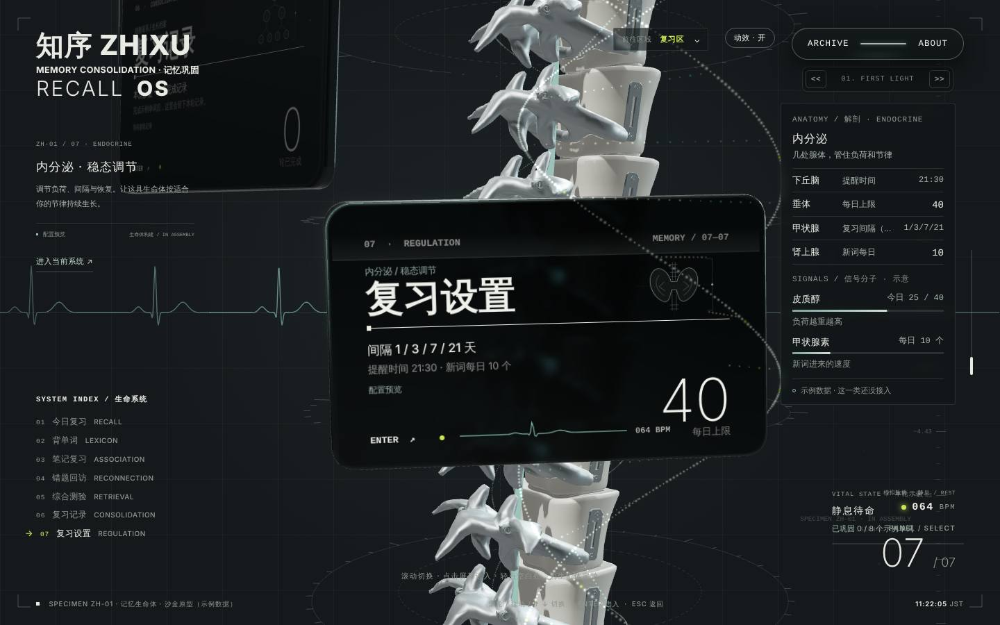
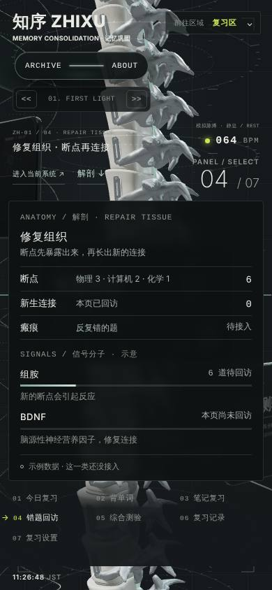

# 脊柱复习区 · 七个系统的解剖与信号

2026-11-04 · 露娜。入口：[脊柱复习区](https://yankcc258.github.io/test-sandbox/recall.html?i=1&workbench=1)。只改了 test-sandbox，正式站没动。

## 为什么做

Yank 很早就想在复习区放进大脑解剖（海马体、杏仁体、前额叶）和神经递质（多巴胺、去甲肾上腺素、血清素、皮质醇）。这次 Yank 特别交代：**复习区还有别的系统，不要只有大脑多出内容**。

所以七个系统一起加，用同一种格式：

- 每个系统有 3–4 处「结构」，各自对应这一类复习里的一个真实数字；
- 每个系统有 2 种「信号分子」，用一根读数条表示高低，下面一行写明它在这里代表什么。

## 七个系统

| 入口     | 系统     | 结构 → 对应什么                                                                       | 信号分子 → 代表什么                                                    |
| -------- | -------- | ------------------------------------------------------------------------------------- | ---------------------------------------------------------------------- |
| 今日复习 | 心脏     | 四个腔室 = 今日的四类来源：右心房 单词 · 左心房 笔记 · 右心室 测验 · 左心室 错题      | 肾上腺素：复习进行时升高 · 乙酰胆碱：完成得越多，节律越平稳            |
| 背单词   | 大脑     | 前额叶 正在回想的卡 · 海马体 本轮还在巩固 · 杏仁体 首次回想模糊或忘了 · 皮层 已经稳定 | 多巴胺：答对时跳一下再回落 · 去甲肾上腺素：还剩多少要回想              |
| 笔记复习 | 神经丛   | 神经元 到期知识点 · 突触簇 按学科成簇 · 髓鞘 复习过多次的（待接入）                   | 乙酰胆碱：编码新关联（占今日比例）· GABA：抑制过载（距每日上限的余量） |
| 错题回访 | 修复组织 | 断点 待回访的错题 · 新生连接 本页已回访 · 瘢痕 反复错的（待接入）                     | 组胺：新的断点 · BDNF（脑源性神经营养因子）：修复连接                  |
| 综合测验 | 感知系统 | 感受器 待输入的题目 · 传入神经 已作答 · 反射弧 独立答对的比例（待接入）               | 腺苷：越久越累（预计用时）· 内啡肽：完成一份后释放                     |
| 复习记录 | 细胞谱系 | 干细胞 本轮要学的词 · 分化细胞 已经巩固的 · 谱系 完成的轮次                           | 血清素：节律稳定 · 褪黑素：东京时间夜里升高（睡眠帮助巩固）            |
| 复习设置 | 内分泌   | 下丘脑 提醒时间 · 垂体 每日上限 · 甲状腺 复习间隔 · 肾上腺 新词每日                   | 皮质醇：负荷（今日量 / 上限）· 甲状腺素：新词进来的速度                |

## 数字从哪里来

面板最下面一行写明来源，标成两种：

- **实时**（实心圆点）：今日复习、背单词、复习记录。它们来自本页的 8 个示例单词的练习，答一题就变。比如答对一个词，「皮层」加一，多巴胺跳一下，几秒后回到基线；首次回想「模糊」或「忘了」的词记在「杏仁体」。褪黑素按东京的实时时间计算。
- **示例**（空心圆点）：笔记、错题、测验、设置。这几类在沙盒里只有示例内容，读数直接取自页面上同一份示例数字（比如错题「物理 3 · 计算机 2 · 化学 1」）。没有数据的写「待接入」，不编数字。

刷新页面后清空，不保存，也不连正式站。

## 准确性

- 这是界面叙事的隐喻，不是医学或神经科学模型。面板标题写的是「信号分子 · 示意」。
- 信号分子里既有神经递质（多巴胺、去甲肾上腺素、乙酰胆碱、GABA），也有激素（肾上腺素、皮质醇、褪黑素、甲状腺素）和其他信号（组胺、腺苷、BDNF）。所以统称「信号分子」，不全叫神经递质。
- 选的对应关系尽量贴近真实作用：比如「从海马体到皮层」本来就是记忆巩固的说法，乙酰胆碱让心率回落，腺苷随清醒时间累积带来疲劳，睡眠中记忆巩固、褪黑素夜里升高。

## 位置与手机

- **电脑**：在右上方，「前往区域」下面、模拟脉搏上面，和左边的标本说明一起随当前系统切换；进入系统内容页时隐藏。
- **手机**：平时收起，「进入当前系统 ↗」旁边多一个「解剖 ↓」，点开后从底部展开，再点收起。
- 字号最小 11px（小编号），说明文字 12px，结构名和信号名 13px。

## 文件

| 文件                 | 内容                                                                                            |
| -------------------- | ----------------------------------------------------------------------------------------------- |
| `recall-anatomy.js`  | 七个系统的结构、信号与读数；`createAnatomy()` 提供 `show / update / grade`                      |
| `recall-anatomy.css` | 面板与手机底部展开的样式                                                                        |
| `recall-spine.js`    | 只加了四处钩子：创建面板；切换系统时 `show`；`updateLife` 里 `update`；背单词每次自评时 `grade` |
| `recall.html`        | 面板容器、手机的「解剖 ↓」按钮、样式表；`recall-spine.js` 版本号 28                             |

## 验证

- `npm run check` 全部通过。
- Chromium 桌面 1440×900、手机 390×844：七个系统逐个切换，面板跟着换；进入背单词，答「记得、忘了、记得」三个词后返回，读数为海马体 6、杏仁体 1、皮层 2，多巴胺跳起后回到基线；手机展开、收起正常。没有脚本错误。
