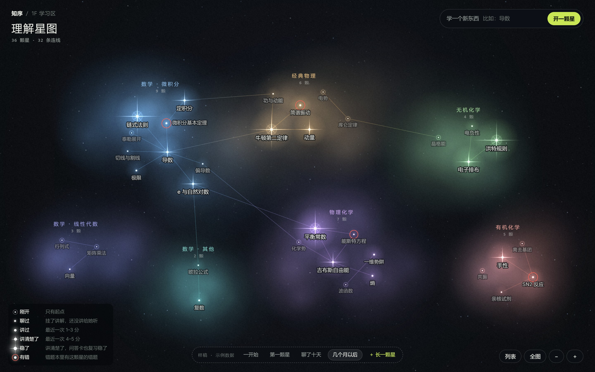
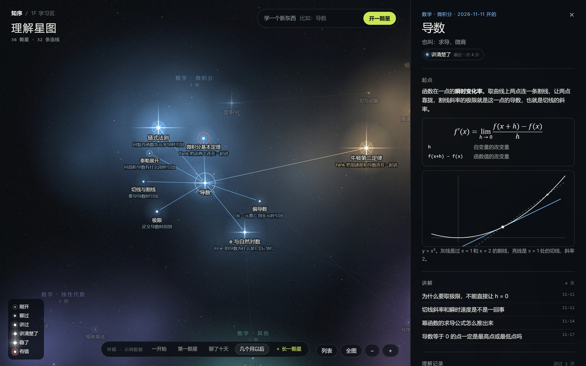

# 理解星图 · 样稿

2026-11-12 · 入口：[`preview/study-stars/`](../../preview/study-stars/)。在分支 `preview/study-stars` 上，已开 PR，等 Yank 合并。Yank 看过静帧，说方向对（2026-11-12），接着往正式站搬。

## 这是什么

知序学习区「理解星图」那张图的样稿，对应正式站设计 `yank-study-lab/docs/study-stars-design.md` 的第四步（S4：沙盒样稿 → Yank 看 → 搬进正式站）。正式站已经做完 S1（开星、起点）和 S2（讲给她听），现在一楼是朴素的列表；这里做的是把列表换成星图以后的样子。

只有示例数据，不连正式站、不连 kiko。

## 画面

| 时刻       | 样子                                                             | 静帧                                                                                             |
| ---------- | ---------------------------------------------------------------- | ------------------------------------------------------------------------------------------------ |
| 一开始     | 只有几片暗暗的星云，标着板块的名字和「还没有星」                 | [empty.jpg](shots/empty.jpg)                                                                     |
| 第一颗星   | 开了「导数」，镜头离近，不留一大片空                             | [first.jpg](shots/first.jpg)                                                                     |
| 聊了十天   | 长出四颗，连线连回导数；牛顿第二定律落在隔壁的经典物理           | [days.jpg](shots/days.jpg)                                                                       |
| 几个月以后 | 36 颗星、32 条连线，七个板块                                     | [grown.jpg](shots/grown.jpg)                                                                     |
| 点一颗星   | 右边展开星的页面；连着的星亮着，名字下面写为什么连，其余的暗下去 | [star.jpg](shots/star.jpg)                                                                       |
| 列表       | 画面之外的列表，按板块分、亮的排前面                             | [list.jpg](shots/list.jpg)                                                                       |
| iPad、手机 | 星的页面从下面出来。手机上只是能用，没细调                       | [ipad.jpg](shots/ipad.jpg) · [ipad-star.jpg](shots/ipad-star.jpg) · [phone.jpg](shots/phone.jpg) |

照设计稿做的：

- **亮度五档**：刚开（小点加细环）、聊过、讲过、讲清楚了（出星芒）、稳了（长星芒加一圈环）；有错另画一圈红。规则在 `model.js` 的 `starLevel`，和设计稿「星的亮度」那张表一条一条对应。
- **平时不动**：星不闪、不漂，背景不转。只有拖、缩放、点开、长出新的星时才画新的帧（检查过：放着不动一秒里不重画）。
- **长出一颗新的星**：新的星亮起来，连线从老的那颗画过来，播一次就停；原来的星钉住不动。
- **星少的时候镜头离近**；星多了退到全图。
- **星的页面**是朴素的写法：起点、讲解、理解记录（分数、他讲的、逐条点评，和上一次比放最前面）、连着的星、「讲给她听」。

这边定的（设计稿没写）：

- 七个板块各自的颜色和在星空里的位置（`model.js` 的 `REGIONS`）。「其他」没有星的时候不画。
- 二维画布，不用 three.js。星和星云先画成小图再贴，星多了也只是贴图。
- 名字写在星的下面；放不下就放旁边，再放不下先不写，放大了再出来。
- 点开一颗星时「为什么连」写在连着的星的名字下面，不写在线上（线上写会压住别的名字）。

## 哪些是真的，哪些是示意

- **真的**：亮度规则、连线两头都画、排布算法（确定的，同样的数据排出来一样）。板块名单和正式站 `STAR_REGIONS` 一致，星的数据形状和 `/api/stars` 一致。
- **示意**：36 颗星、每颗的起点第一句、讲解和理解记录都是编的示例，不是 Yank 的学习记录。只有「导数」写了完整的起点和两次理解记录。星的页面里的公式和函数图是手写的，不是正式站的积木。「开一颗星」「讲给她听」不连 kiko。

## 文件

`preview/study-stars/`：`model.js`（板块、亮度、连线）、`layout.js`（排布）、`render.js`（画）、`app.js`（镜头、操作、星的页面、列表）、`data.js`（示例数据）、`stars.css`、`index.html`。

地址参数：`?stage=empty|first|days|grown`、`&open=导数`、`&list=1`、`&motion=0`（不放动画）。

## 检查

- `npm run check` 里（`check:laboratory`）加了 `scripts/check-study-stars.mjs`：亮度表、示例数据、连线、排布（确定、名字不叠、板块分得开、长新星时老的星挪动不超过 30）。
- `scripts/check-study-stars-browser.mjs`（要浏览器，用法在文件开头）：电脑 1440×900 用真实鼠标走一遍（一开始只有板块 → 放着不重画 → 长一颗星、动画播完就停 → 点星打开页面 → 点连着的星 → 拖动、滚轮缩放 → Esc 关上 → 列表点开 → 「学一个新东西」）；iPad 竖屏触摸；关闭动效加星的直链。
- 2026-11-12 在这台电脑上用 Chrome 跑过，三组都通过，没有脚本错误；九张静帧逐张看过。`npm run check` 全部通过。

## 没做的

- **Yank 只看过静帧**，没有自己拖着看过；连续的动画好不好看要他看。
- **正式站那边搬了，还没合并。** 2026-11-12 搬进 `yank-study-lab` 的分支 `feat/study-stars-map`（v3.26.0：`src/stars-map.js`、`stars-map.css`，接 `/api/stars` 和讲给她听的记录，星的页面用正式站原来那一页）。那边现在亮得起来的只有刚开、讲过、讲清楚了三档；聊过、稳了、有错要等讲解、问答卡、错题挂到星上。以后在正式站改，这里的样稿留作示例数据的对照。
- **帧率没量，iPad 和手机真机没验。** 手机上全图很小，只是能用。
- **星很多的时候没试。** 排布是两两比较，几百颗没问题，正式站上限 2000 颗时要换算法或者只排新长的。
- 动画只看过开头和结尾的状态，连续播放好不好看要 Yank 自己看。
- 没有键盘在星之间移动（列表可以用键盘）。
